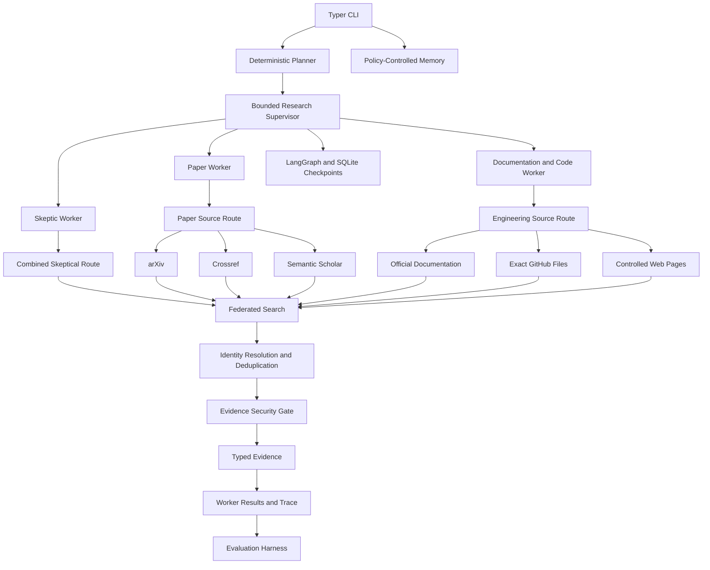

<div align="center">

<h1>
  <kbd>&nbsp;𝚁𝚎𝚜𝚎𝚊𝚛𝚌𝚑 𝙲𝙻𝙸 𝙰𝚐𝚎𝚗𝚝t&nbsp;</kbd>
</h1>

### A bounded, observable, and evaluation-driven multi-agent research system

</div>

A `command-line research agent` tackling engineering problems for reliable agentic systems:

- bounded agent loops;
- typed tool contracts;
- hybrid retrieval;
- explicit memory policy;
- concurrent specialist workers;
- durable checkpoint recovery;
- controlled external research;
- provenance-preserving evidence;
- deterministic and model-based agent evaluations.

The project intentionally emphasizes runtime correctness, observability, failure containment, and evaluation over frontend development.

## Main capabilities

### Bounded agent runtime

The model proposes actions, but the application runtime retains execution authority.

```text
model proposal
      ↓
typed decision parser
      ↓
tool registry and schema validation
      ↓
policy and budget checks
      ↓
tool execution
      ↓
structured observation
      ↓
next bounded decision
```

The loop enforces:

- validated tool names and arguments;
- maximum step limits;
- structured decisions;
- deterministic termination;
- trace events;
- provider-neutral model interfaces.

### Hybrid local retrieval

The local retrieval system supports:

- deterministic Markdown and text ingestion;
- stable document and chunk identifiers;
- overlapping word-window chunking;
- dense vector retrieval;
- BM25 lexical retrieval;
- reciprocal-rank fusion;
- Recall@k evaluation.

```text
documents
   ↓
typed ingestion
   ↓
stable chunking
   ├── dense retrieval
   └── BM25 retrieval
          ↓
 reciprocal-rank fusion
          ↓
 ranked source-preserving evidence
```

### Policy-controlled long-term memory

Long-term memory is not the same thing as conversation history.

The memory subsystem provides:

- explicit allowlisted memory categories;
- user and session ownership;
- policy validation before persistence;
- semantic recall;
- deletion by logical memory identifier;
- a Supermemory provider adapter;
- deterministic in-memory tests.

Supported memory categories include:

- `user_preference`
- `durable_fact`
- `research_interest`
- `session_summary`

### Multi-agent orchestration

A deterministic planner creates three independent specialist assignments:

| Worker | Responsibility |
|---|---|
| `papers` | Research findings, benchmarks, empirical evidence, and limitations |
| `documentation_code` | APIs, architecture, implementation guidance, and engineering constraints |
| `skeptic` | Counterexamples, unsupported assumptions, risks, and missing evidence |

The supervisor enforces:

- maximum worker count;
- maximum concurrency;
- per-worker decision budgets;
- per-worker tool budgets;
- stable result ordering;
- failure isolation;
- cancellation propagation;
- observable peak concurrency.

### Durable workflows

The durable runtime uses LangGraph with SQLite checkpoints.

It supports:

- stable run identifiers;
- plan fingerprints;
- checkpointed worker state;
- application-owned timeouts;
- bounded retry attempts;
- attempt records;
- resume after interruption;
- prevention of repeated successful work;
- refusal to reuse a run ID with a different plan.

### Controlled external research

The `live-web-search` command connects the orchestration runtime to:

- arXiv;
- Crossref;
- Semantic Scholar;
- official documentation pages;
- exact GitHub repository files at explicit refs;
- administrator-approved web pages.

This is not unrestricted web browsing.

Scholarly providers perform query-based search. Documentation, GitHub, and controlled-web sources operate only on targets defined in the local allowlist.

External evidence is normalized with:

- provider identity;
- canonical URL;
- publication metadata;
- DOI, arXiv, and Semantic Scholar identifiers;
- canonical cross-provider identity;
- provider lineage;
- content hashes;
- evidence scope;
- prompt-injection risk flags;
- synthesis eligibility.

### Agent evaluation harness

The evaluation subsystem runs complete tasks rather than testing isolated prompts.

It supports:

- task suites;
- repeated trials;
- multiple graders;
- deterministic and Gemini profiles;
- observable trajectories;
- citation-integrity checks;
- tool and model call counts;
- latency percentiles;
- nominal token-cost estimates;
- baseline comparisons;
- regression gates;
- JSON, Markdown, and JSONL artifacts.

---

## Architecture



---

## Repository layout

```text
src/research_agent/
├── cli.py
├── domain.py
├── loop.py
├── ports.py
├── tools.py
├── durable/
│   ├── graph.py
│   ├── models.py
│   ├── policy.py
│   ├── runtime.py
│   └── synthesis.py
├── evaluation/
│   ├── gemini.py
│   ├── graders.py
│   ├── harness.py
│   ├── metrics.py
│   ├── models.py
│   ├── pricing.py
│   ├── regression.py
│   ├── reporting.py
│   └── systems.py
├── memory/
│   ├── in_memory.py
│   ├── models.py
│   ├── policy.py
│   ├── service.py
│   └── supermemory.py
├── orchestration/
│   ├── models.py
│   ├── planner.py
│   ├── ports.py
│   ├── supervisor.py
│   └── worker.py
├── retrieval/
│   ├── bm25.py
│   ├── chunking.py
│   ├── dense.py
│   ├── embeddings.py
│   ├── evaluation.py
│   ├── hybrid.py
│   ├── ingestion.py
│   ├── lab.py
│   ├── models.py
│   └── ports.py
└── sources/
    ├── adapters.py
    ├── evidence.py
    ├── federation.py
    ├── http.py
    ├── identity.py
    ├── ledger.py
    ├── live.py
    ├── routing.py
    ├── scholarly.py
    ├── security.py
    └── web.py
```

---

## Requirements

- Python 3.12 or newer
- [uv](https://docs.astral.sh/uv/)
- Internet access only for live-source, Supermemory, or Gemini operations
- A Crossref contact email for live scholarly research

A GPU is optional. Local embeddings can run on CPU.

---

## Installation

Clone the repository and enter it:

```powershell
git clone YOUR_REPOSITORY_URL
cd research-cli-agent
```

Install the project and development dependencies:

```powershell
uv sync
```

Inspect the CLI:

```powershell
uv run research-agent --help
```

The first local dense-retrieval run may download the configured Sentence Transformers model.

---

## Environment variables

Set only the credentials required for the features you use.

```powershell
# Required for live external research
$env:CROSSREF_MAILTO="your-email@example.com"

# Optional live-source credentials
$env:SEMANTIC_SCHOLAR_API_KEY="your-semantic-scholar-key"
$env:GITHUB_TOKEN="your-github-token"

# Required for Supermemory commands
$env:SUPERMEMORY_API_KEY="your-supermemory-key"

# Required for Gemini evaluation
$env:GEMINI_API_KEY="your-gemini-key"
```

Never commit real credentials.

The project includes `.env.example` as documentation, but does not automatically load `.env` files.

---

## Quick start

### Deterministic bounded agent loop

```powershell
uv run research-agent demo `
  "reliable agents preserve explicit state"
```

Show or hide the execution trace:

```powershell
uv run research-agent demo `
  --no-trace `
  "reliable agents preserve explicit state"
```

### Search a local research corpus

```powershell
uv run research-agent retrieve `
  --corpus examples/corpus `
  --mode hybrid `
  --top-k 5 `
  --device cpu `
  "agent checkpoint recovery"
```

Available retrieval modes:

- `dense`
- `bm25`
- `hybrid`

### Run the local multi-agent workflow

```powershell
uv run research-agent research `
  --corpus examples/corpus `
  --device cpu `
  "How should production agents recover from tool failures?"
```

### Run a durable checkpointed workflow

```powershell
uv run research-agent durable-research `
  --run-id recovery-study-001 `
  --checkpoint-db .state/research.sqlite `
  --worker-timeout 15 `
  --max-attempts 2 `
  --corpus examples/corpus `
  --device cpu `
  "How should production agents recover from partial failure?"
```

Run the same command again with the same run ID and plan to resume or reuse completed state.

A reused run ID with a different plan is rejected.

---

## Live external research

### Source configuration

`configs/live_sources.json` defines the exact documentation, GitHub, and controlled-web targets that the runtime may access.

Example:

```json
{
  "official_documentation": [
    {
      "title": "Python asyncio tasks and task groups",
      "url": "https://docs.python.org/3/library/asyncio-task.html"
    }
  ],
  "github": [
    {
      "owner": "python",
      "repository": "cpython",
      "path": "Lib/asyncio/taskgroups.py",
      "ref": "v3.13.5"
    }
  ],
  "controlled_web": [
    {
      "title": "Anthropic — Building Effective AI Agents",
      "url": "https://www.anthropic.com/engineering/building-effective-agents"
    }
  ]
}
```

GitHub targets should use immutable commit hashes or release tags whenever possible.

### Run live research

```powershell
$env:CROSSREF_MAILTO="your-email@example.com"

uv run research-agent live-web-search `
  --prompt "How should production agents recover from partial workflow failure?" `
  --sources-config configs/live_sources.json `
  --request-timeout 20 `
  --trace
```

The command:

1. validates the prompt and allowlist;
2. creates one bounded asynchronous HTTP client;
3. constructs all approved source adapters;
4. routes sources by worker role;
5. runs at most two workers concurrently;
6. federates results while isolating provider failures;
7. deduplicates scholarly evidence;
8. screens evidence for obvious instruction attacks;
9. prints worker results, provenance, URLs, risk flags, and traces.

The command is deterministic at the decision layer. It does not use Gemini to generate a narrative report.

---

## Long-term memory

### Remember

```powershell
uv run research-agent memory remember `
  --user-id babu `
  --session-id research-session-1 `
  --kind research_interest `
  "I research reliable multi-agent systems"
```

### Recall

```powershell
uv run research-agent memory recall `
  --user-id babu `
  "What kind of agent systems do I research?"
```

### Forget

```powershell
uv run research-agent memory forget `
  --user-id babu `
  MEMORY_ID_RETURNED_BY_REMEMBER
```

Memory writes are rejected unless they satisfy the explicit policy. Retrieved provider data is converted back into application-owned memory models.

---

## Retrieval evaluation

Evaluate Recall@k across dense, BM25, and hybrid retrieval:

```powershell
uv run research-agent evaluate-retrieval `
  --corpus examples/corpus `
  --cases evals/retrieval_cases.json `
  --top-k 2 `
  --device cpu
```

The same stable chunk identifiers are used across ingestion and evaluation, allowing labeled retrieval cases to remain reproducible while the corpus remains unchanged.

---

## Agent evaluation

### Deterministic profile

```powershell
uv run research-agent evaluate-agent `
  --profile deterministic `
  --trials 1 `
  --suite evals/agent_tasks.json `
  --corpus examples/corpus `
  --device cpu `
  --output evals/results/deterministic
```

### Write a regression baseline

```powershell
uv run research-agent evaluate-agent `
  --profile deterministic `
  --trials 1 `
  --output evals/results/deterministic `
  --write-baseline evals/baselines/deterministic.json
```

### Compare against a baseline

```powershell
uv run research-agent evaluate-agent `
  --profile deterministic `
  --trials 1 `
  --baseline evals/baselines/deterministic.json `
  --output evals/results/deterministic-regression
```

### Gemini smoke evaluation

```powershell
$env:GEMINI_API_KEY="your-key"

uv run research-agent evaluate-agent `
  --profile gemini `
  --trials 1 `
  --task-limit 3 `
  --model gemini-2.5-flash `
  --output evals/results/gemini-smoke
```

Evaluation artifacts include:

```text
report.json
summary.md
trajectories.jsonl
```

Measured properties include:

- trial pass rate;
- consistent task rate;
- pass@k;
- citation integrity;
- p95 latency;
- tool calls;
- model calls;
- nominal model cost;
- regression-gate status.

---

## Testing and quality gates

Run the complete test suite:

```powershell
uv run pytest -v
```

Format and lint:

```powershell
uv run ruff format src tests
uv run ruff check src tests
```

Run static type checking:

```powershell
uv run pyright src tests
```

A CLI demonstration is not considered successful unless tests, linting, and type checking also pass.

Live provider tests should remain opt-in because external APIs are mutable:

```powershell
$env:RUN_LIVE_SOURCE_TESTS="1"
$env:CROSSREF_MAILTO="your-email@example.com"

uv run pytest -v -m live
```

Normal unit tests use controlled HTTP transports and do not require network access.

---

## Reliability model

### The model proposes; the runtime authorizes

Model output is treated as untrusted input.

The runtime validates:

- decision type;
- tool name;
- tool arguments;
- step budget;
- tool budget;
- worker budget;
- concurrency budget;
- timeout policy;
- retry policy;
- source authority.

### Failures become structured outcomes

A worker failure is represented as data so successful sibling work can remain available.

Cancellation is different: it represents orchestration control and must propagate rather than being disguised as an ordinary worker result.

### Idempotency and durable execution

Checkpoint recovery avoids repeating successful workers.

External side effects would additionally require idempotency keys because a timeout does not prove that the remote operation failed. The remote service may have completed the action before the response was lost.

### Evidence is not truth

Correct tool execution can still return irrelevant, outdated, incomplete, or misleading evidence.

Retrieval correctness and answer correctness are separate evaluation problems.

---

## External-source security

The external retrieval boundary enforces:

- HTTPS-only source URLs;
- explicit host allowlists;
- no automatic redirect trust;
- accepted content-type checks;
- maximum response sizes;
- bounded client timeouts;
- exact GitHub paths and refs;
- deterministic evidence identifiers;
- content hashes;
- prompt-injection risk flags;
- quarantine through `eligible_for_synthesis=False`.

The risk scanner is a defense-in-depth mechanism, not a complete prompt-injection solution.

External content never receives authority to:

- modify the source allowlist;
- invoke shell commands;
- access secrets;
- select arbitrary tools;
- change runtime policy;
- create new external targets.

---

## Important limitations

- `live-web-search` is controlled federated research, not an unrestricted search engine.
- Documentation and web adapters fetch exact administrator-approved pages.
- The deterministic worker currently summarizes its highest-ranked eligible evidence rather than generating a full narrative literature review.
- Provider APIs, schemas, quotas, and availability can change.
- Regex-based injection detection cannot identify every adversarial instruction.
- Local word-window chunking is intentionally simple and is not document-layout aware.
- The project does not yet provide a graphical interface.

These limitations are explicit because trustworthy agent engineering requires knowing what a system does not guarantee.

---

## Engineering principles implemented

1. Provider-neutral interfaces over vendor coupling.
2. Typed boundaries over loose dictionaries.
3. Runtime authority over model authority.
4. Deterministic infrastructure beneath probabilistic models.
5. Bounded work over open-ended autonomy.
6. Failure isolation without silent failure.
7. Checkpointed state over implicit recovery.
8. Explicit memory policy over automatic retention.
9. Evidence provenance over unsupported generation.
10. Evaluation gates over demo-driven confidence.
