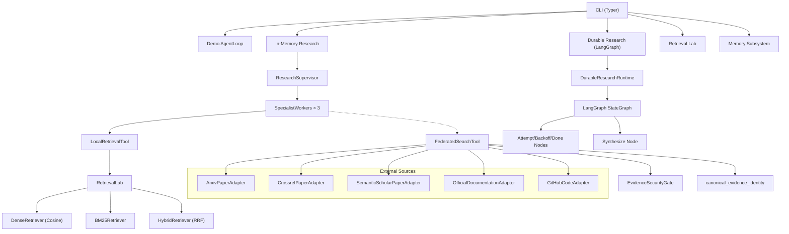
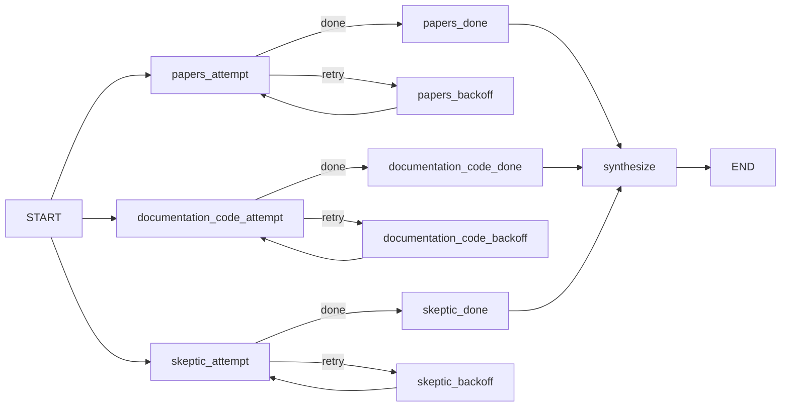

# Research CLI Agent — Complete Codebase Deep Dive

> **Purpose**: Comprehensive analysis for interview preparation. Every architectural pattern, design decision, and engineering trade-off is catalogued below.

---

## 1. Project Identity

| Property | Value |
|---|---|
| **Name** | `ml-research-cli-agent` |
| **Python** | ≥ 3.12 |
| **Build** | Hatchling |
| **Entry point** | `research-agent` → [`cli.py:app`](file:///d:/AI-agents/research-cli-agent/src/research_agent/cli.py) |
| **Key frameworks** | Pydantic v2, Typer, Rich, LangGraph, Sentence Transformers, NumPy, httpx, supermemory |

---

## 2. High-Level Architecture



---

## 3. Module-by-Module Breakdown

### 3.1 Domain Layer ([`domain.py`](file:///d:/AI-agents/research-cli-agent/src/research_agent/domain.py))

The foundational types for the **basic agent loop** (not the research orchestration):

| Type | Purpose |
|---|---|
| `Message` | Chat message with `role` ∈ {user, assistant, tool} |
| `ToolSpec` | Name + description + JSON schema shown to model |
| `ToolCallDecision` | Model proposes invoking a tool |
| `FinalDecision` | Model proposes terminating with an answer |
| `Decision` | Discriminated union of the above two (via `kind` field) |
| `TraceEvent` | Observable event: `model_decision` or `tool_result` |
| `AgentResult` | Terminal output: answer + messages + trace + step count |

**Key Design**: `Decision` uses Pydantic's `Field(discriminator="kind")` — a typed tagged union that avoids `isinstance` checks at the boundary.

---

### 3.2 Ports (Protocol Boundaries)

#### Root Ports ([`ports.py`](file:///d:/AI-agents/research-cli-agent/src/research_agent/ports.py))

```python
class ModelClient(Protocol):
    def decide(self, messages, tools) -> Decision

class Tool(Protocol):
    @property
    def spec(self) -> ToolSpec
    def invoke(self, arguments) -> str
```

#### Orchestration Ports ([`orchestration/ports.py`](file:///d:/AI-agents/research-cli-agent/src/research_agent/orchestration/ports.py))

```python
class WorkerDecider(Protocol):    # "brain" of a worker
    async def decide(assignment, observations) -> WorkerDecision

class AsyncSearchTool(Protocol):   # "hands" of a worker
    async def search(query, top_k) -> tuple[WorkerEvidence, ...]

class ResearchWorker(Protocol):    # entire worker lifecycle
    async def run(assignment, budget) -> WorkerResult
```

#### Memory Ports ([`memory/ports.py`](file:///d:/AI-agents/research-cli-agent/src/research_agent/memory/ports.py))

```python
class MemoryStore(Protocol):
    def add(memory) -> MemoryWriteReceipt
    def search(user_id, query, top_k) -> list[MemoryHit]
    def delete(user_id, memory_id) -> bool
```

#### Retrieval Ports ([`retrieval/ports.py`](file:///d:/AI-agents/research-cli-agent/src/research_agent/retrieval/ports.py))

```python
class Embedder(Protocol):
    def embed_documents(texts) -> FloatMatrix
    def embed_query(text) -> FloatVector

class Retriever(Protocol):
    def search(query, top_k) -> list[SearchHit]
```

> **Interview Point**: The entire system uses Python **`Protocol`** classes (structural subtyping) instead of abstract base classes. This means you never inherit; you just implement the same method signatures. This is the **Ports and Adapters** (Hexagonal Architecture) pattern — all external dependencies flow through narrow Protocol boundaries, making every component independently testable with fakes/mocks.

---

### 3.3 Agent Loop ([`loop.py`](file:///d:/AI-agents/research-cli-agent/src/research_agent/loop.py))

A **bounded ReAct loop**:

```
1. Send messages + tool specs to ModelClient.decide()
2. If FinalDecision → return AgentResult
3. If ToolCallDecision → invoke tool via ToolRegistry → append observation → goto 1
4. If step counter hits max_steps → raise StepLimitExceeded
```

**Boundedness guarantee**: `max_steps` is enforced by the runtime, not by the model. The model cannot run forever even if it never decides to finish.

---

### 3.4 Tool System ([`tools.py`](file:///d:/AI-agents/research-cli-agent/src/research_agent/tools.py))

- `ToolRegistry` — **allowlisted** dictionary of tools; prevents arbitrary tool invocation
- `WordCountTool` — demo tool with Pydantic input validation via `WordCountInput`
- The flow: **model proposes** tool name + args → registry checks name exists → Pydantic validates input → tool executes → string result returned

> **Interview Point**: The tool invocation pipeline has 3 safety layers: (1) tool name must exist in the allowlist, (2) Pydantic validates the arguments schema, (3) each tool does its own business-rule validation.

---

### 3.5 Research Orchestration

#### 3.5.1 Models ([`orchestration/models.py`](file:///d:/AI-agents/research-cli-agent/src/research_agent/orchestration/models.py))

Core typed contracts — **all frozen Pydantic models**:

| Model | Purpose |
|---|---|
| `WorkerRole` | Literal type: `"papers"`, `"documentation_code"`, `"skeptic"` |
| `WorkerBudget` | Per-worker limits: `max_decisions=3`, `max_tool_calls=2` |
| `ResearchBudget` | Run-level: `max_workers=3`, `max_concurrency=2`, per_worker budget |
| `WorkerAssignment` | One task: task_id, role, question, expected_output |
| `ResearchPlan` | Validated collection with unique task_ids and unique roles |
| `WorkerEvidence` | Evidence snapshot with provenance: source, score, rank, identifiers, security flags, eligibility |
| `SearchDecision` / `FinishDecision` | Worker proposals (tagged union via `kind`) |
| `WorkerResult` | Terminal outcome with evidence, usage metrics, timing, trace |
| `ResearchRun` | Complete supervisor result with plan, results, peak concurrency, trace |

**Key validation rules**:
- `ResearchBudget`: `max_concurrency ≤ max_workers` (enforced by `model_validator`)
- `ResearchPlan`: task_ids must be unique, roles must be unique
- `WorkerAssignment`: all text fields are whitespace-normalized

#### 3.5.2 Planner ([`orchestration/planner.py`](file:///d:/AI-agents/research-cli-agent/src/research_agent/orchestration/planner.py))

`DeterministicPlanner` creates a **fixed 3-assignment plan** from any question:

1. **Papers worker** — finds research evidence, benchmarks, limitations
2. **Documentation/code worker** — finds implementation guidance, API constraints
3. **Skeptic worker** — finds counterexamples, failure modes, missing evidence

> **Interview Point**: The planner is deterministic on purpose. It decomposes a question into 3 complementary perspectives (evidence, implementation, critique). A future LLM-based planner could replace this while preserving the same `ResearchPlan` contract.

#### 3.5.3 Supervisor ([`orchestration/supervisor.py`](file:///d:/AI-agents/research-cli-agent/src/research_agent/orchestration/supervisor.py))

The **concurrent executor** for in-memory research:

1. Validates plan against budget (worker count, role registration)
2. Creates an `asyncio.Semaphore(max_concurrency)` to cap parallelism
3. Uses `asyncio.TaskGroup` to run all workers concurrently
4. Tracks `active_workers` and `peak_concurrency` with a state lock
5. Records `SupervisorTraceEvent` for every start/finish
6. Catches exceptions per-worker (creates a failed WorkerResult) without poisoning siblings
7. Returns `ResearchRun` with all results + trace

**Concurrency model**: `TaskGroup` (structured concurrency) + `Semaphore` (bounded parallelism) + `Lock` (state mutation). This is the textbook Python async supervisor pattern.

#### 3.5.4 Worker Runtime ([`orchestration/worker.py`](file:///d:/AI-agents/research-cli-agent/src/research_agent/orchestration/worker.py))

`SpecialistWorker` is the **bounded worker loop**:

```
while True:
  if decision_calls ≥ budget.max_decisions → return budget_exhausted
  decision = await decider.decide(assignment, observations)
  if FinishDecision → return completed
  if SearchDecision:
    if tool_calls ≥ budget.max_tool_calls → return budget_exhausted
    evidence = await search_tool.search(query, top_k)
    observations.append(evidence)
```

`DeterministicWorkerDecider` is the simplest policy:
1. First call → search with the assignment question
2. After search → finish with the top eligible evidence or "no evidence found"

`LocalRetrievalTool` wraps the sync `RetrievalLab` in an async boundary with a lock (serialized access to the embedding model).

---

### 3.6 Retrieval Subsystem

A clean **4-stage pipeline**: Ingestion → Chunking → Indexing → Search

#### 3.6.1 Ingestion ([`retrieval/ingestion.py`](file:///d:/AI-agents/research-cli-agent/src/research_agent/retrieval/ingestion.py))

- Walks a directory for `.md` and `.txt` files in **sorted order** (reproducible IDs)
- Skips unreadable/empty files with warnings (graceful degradation)
- Returns `list[ResearchDocument]` with content-derived `doc_id` (UUID5)

#### 3.6.2 Models ([`retrieval/models.py`](file:///d:/AI-agents/research-cli-agent/src/research_agent/retrieval/models.py))

- **`ResearchDocument`** — frozen, content-hashed (`sha256`), with stable UUID5 `doc_id` derived from `(source_path, checksum)`. Frozen to prevent invalidating the hash.
- **`Chunk`** — overlapping window of a document. `chunk_id = UUID5(doc_id, chunk_index)`. Carries `start_word/end_word` for traceable citation spans.
- **`SearchHit`** — `chunk_id + rank + score + retriever`
- **`LabeledQuery`** — ground truth for recall@k evaluation

> **Interview Point**: IDs are content-derived, not counter-derived. Re-ingesting an unchanged corpus produces identical IDs, which is essential for recall@k evaluation to stay valid across runs.

#### 3.6.3 Chunking ([`retrieval/chunking.py`](file:///d:/AI-agents/research-cli-agent/src/research_agent/retrieval/chunking.py))

`WordWindowChunker` — fixed-size overlapping word windows:
- `window_size=120` words, `overlap=20` words → stride = 100
- Pure in-memory transform, no I/O
- Last window is truncated (not padded)
- Designed to be replaceable by sentence-aware or contextual chunking (Anthropic-style)

#### 3.6.4 Dense Retrieval ([`retrieval/dense.py`](file:///d:/AI-agents/research-cli-agent/src/research_agent/retrieval/dense.py))

- Embeds all chunks at init → normalized matrix
- Query: embed → normalize → `matrix @ query_vector` (cosine similarity via dot product on L2-normalized vectors)
- Pure numpy, no FAISS dependency

#### 3.6.5 BM25 Retrieval ([`retrieval/bm25.py`](file:///d:/AI-agents/research-cli-agent/src/research_agent/retrieval/bm25.py))

Full BM25 from scratch:
- `k1=1.5`, `b=0.75` (standard Robertson parameters)
- Tokenization: `\b\w+\b` casefolded
- IDF: `log(1 + (N - df + 0.5) / (df + 0.5))`
- TF: `idf * tf * (k1 + 1) / (tf + k1 * (1 - b + b * dl/avgdl))`

#### 3.6.6 Hybrid Retrieval ([`retrieval/hybrid.py`](file:///d:/AI-agents/research-cli-agent/src/research_agent/retrieval/hybrid.py))

**Reciprocal Rank Fusion (RRF)**:
- Fetches `candidate_multiplier × top_k` candidates from each retriever
- Fuses with `RRF_score = Σ 1/(K + rank)` where K=60
- Solves the score incommensurability problem (cosine ≠ BM25 scale)

#### 3.6.7 Lab ([`retrieval/lab.py`](file:///d:/AI-agents/research-cli-agent/src/research_agent/retrieval/lab.py))

`RetrievalLab.from_corpus()` is the one-call factory:
`corpus → load_documents → WordWindowChunker.split → DenseRetriever + BM25Retriever + HybridRetriever`

#### 3.6.8 Embeddings ([`retrieval/embeddings.py`](file:///d:/AI-agents/research-cli-agent/src/research_agent/retrieval/embeddings.py))

`SentenceTransformerEmbedder` wrapping `sentence-transformers/all-MiniLM-L6-v2`. Uses `encode_document`/`encode_query` (asymmetric encoding).

#### 3.6.9 Evaluation ([`retrieval/evaluation.py`](file:///d:/AI-agents/research-cli-agent/src/research_agent/retrieval/evaluation.py))

`evaluate_recall` computes **Recall@k** against labeled queries from `evals/retrieval_cases.json`.

---

### 3.7 External Sources Subsystem

#### 3.7.1 Adapters ([`sources/adapters.py`](file:///d:/AI-agents/research-cli-agent/src/research_agent/sources/adapters.py))

Three adapter types, all implementing `EvidenceSource` (search method):

| Adapter | Source | Key Detail |
|---|---|---|
| `ArxivPaperAdapter` | arXiv Atom API | Extracts terms → `all:term1 AND all:term2`, parses XML with `defusedxml` |
| `OfficialDocumentationAdapter` | Pre-approved URLs | BeautifulSoup → strip nav/script → `best_excerpt` |
| `GitHubCodeAdapter` | GitHub Contents API | Immutable `ref` (tag/SHA), raw file content |

#### 3.7.2 Scholarly Adapters ([`sources/scholarly.py`](file:///d:/AI-agents/research-cli-agent/src/research_agent/sources/scholarly.py))

| Adapter | Source | Extra |
|---|---|---|
| `CrossrefPaperAdapter` | Crossref REST API | Requires `mailto`, strips HTML from abstracts |
| `SemanticScholarPaperAdapter` | S2 Graph API | Optional API key, extracts externalIds (DOI, ArXiv) |

#### 3.7.3 Evidence Construction ([`sources/evidence.py`](file:///d:/AI-agents/research-cli-agent/src/research_agent/sources/evidence.py))

`make_external_evidence()` — factory that constructs validated `WorkerEvidence` with:
- Deterministic `chunk_id = sha256(provider + source_id + text)[:24]`
- Provider chain tracking
- Normalized provider/title/text

#### 3.7.4 Security Gate ([`sources/security.py`](file:///d:/AI-agents/research-cli-agent/src/research_agent/sources/security.py))

`EvidenceSecurityGate` — regex-based prompt injection scanner:
- **5 risk patterns**: instruction_override, role_override, prompt_exfiltration, secret_exfiltration, tool_instruction
- Flags evidence with `risk_flags` and sets `eligible_for_synthesis = False`
- Also computes `content_sha256` for integrity verification

> **Interview Point**: This is a defense-in-depth measure, not a complete solution. The docstring explicitly says "obvious attacks without pretending regex is complete security." Flagged evidence is **quarantined** but retained for audit, not silently dropped.

#### 3.7.5 Identity Resolver ([`sources/identity.py`](file:///d:/AI-agents/research-cli-agent/src/research_agent/sources/identity.py))

`canonical_evidence_identity()` resolves a provider-neutral identity:
- Priority: DOI → arXiv ID → Semantic Scholar ID → title+year hash → snapshot fallback
- `merge_duplicate_evidence()` keeps the richer snapshot (by scope richness × text length) while merging provider chains

#### 3.7.6 Federation ([`sources/federation.py`](file:///d:/AI-agents/research-cli-agent/src/research_agent/sources/federation.py))

`FederatedSearchTool` — bounded fan-out:
1. `asyncio.gather` across all sources (parallel)
2. Individual source failures return `None` (graceful degradation)
3. If ALL fail → raise `SourceUnavailable`
4. Round-robin interleaving (offset-major order)
5. Security screening → canonical identity → deduplication → re-ranking

#### 3.7.7 Routing ([`sources/routing.py`](file:///d:/AI-agents/research-cli-agent/src/research_agent/sources/routing.py))

`RoleSourceRouter` — maps each `WorkerRole` to its approved source collection:
- `papers` → ArxivPaperAdapter
- `documentation_code` → OfficialDocsAdapter + GitHubCodeAdapter
- `skeptic` → all adapters with skeptical queries

#### 3.7.8 Claim Ledger ([`sources/ledger.py`](file:///d:/AI-agents/research-cli-agent/src/research_agent/sources/ledger.py))

`ClaimLedgerVerifier` — mechanical citation integrity (not semantic truth):
1. Each `ClaimDraft` has `citations` (evidence_id + verbatim quote)
2. Verification checks: evidence exists → SHA256 matches → quote is substring → not quarantined
3. Statuses: `citation_verified`, `unsupported`, `invalid_citation`, `quarantined_source`

---

### 3.8 Durable Execution (LangGraph)

The **checkpointable** variant of the research system using LangGraph's `StateGraph`.

#### 3.8.1 State Model ([`durable/models.py`](file:///d:/AI-agents/research-cli-agent/src/research_agent/durable/models.py))

`DurableResearchState` is a `TypedDict` (not Pydantic) because LangGraph requires primitive-only serializable state. Uses `Annotated[..., merge_mappings]` reducers for parallel branch merging.

Key functions:
- `normalize_run_id()` — regex validation `[A-Za-z0-9][A-Za-z0-9._-]{0,63}`
- `plan_fingerprint()` — SHA256 of canonical JSON (detects plan conflicts on resume)
- `make_initial_state()` — validates required roles and creates initial empty state

#### 3.8.2 Graph Construction ([`durable/graph.py`](file:///d:/AI-agents/research-cli-agent/src/research_agent/durable/graph.py))



**Three parallel branches**, each with retry loops. `DurableResearchNodes` provides:
- `attempt_node(role)` — runs worker with `asyncio.timeout`, records attempt, decides retry
- `route_node(role)` — conditional edge: "retry" or "done"
- `backoff_node(role)` — sleeps for computed backoff duration
- `synthesize_node` — deterministic report synthesis

#### 3.8.3 Policy ([`durable/policy.py`](file:///d:/AI-agents/research-cli-agent/src/research_agent/durable/policy.py))

`WorkerExecutionPolicy` — controls retries:
- `max_attempts=2` (1 initial + 1 retry)
- `timeout_seconds=15`
- Retryable: `timed_out` or failed with `SourceTimeout`/`SourceRateLimited`/`SourceUnavailable`
- **Exponential backoff with jitter**: `delay = min(max_backoff, initial * 2^(attempt-1)) * (1 ± jitter_ratio * random)`
- `random_fraction` is injected for deterministic testing

#### 3.8.4 Runtime ([`durable/runtime.py`](file:///d:/AI-agents/research-cli-agent/src/research_agent/durable/runtime.py))

`DurableResearchRuntime` — SQLite-backed create-or-resume:
1. Normalizes run_id
2. Opens `AsyncSqliteSaver`
3. Checks for existing checkpoint
4. If resuming: validates plan fingerprint matches (prevents reuse with different plans)
5. If fresh: creates initial state
6. After graph completes: materializes `DurableResearchRun` from final state

#### 3.8.5 Synthesis ([`durable/synthesis.py`](file:///d:/AI-agents/research-cli-agent/src/research_agent/durable/synthesis.py))

`DeterministicPartialSynthesizer` — creates a structured text report without an LLM:
- Classifies status: all completed → "completed", none → "failed", partial → "partial"
- Lists each worker outcome with eligible evidence count
- Warns on partial results

---

### 3.9 Context Composer ([`context.py`](file:///d:/AI-agents/research-cli-agent/src/research_agent/context.py))

`ContextComposer` — deterministic model context construction with **hard token budgets**:

```
<system_instructions>...</system_instructions>
<current_query>...</current_query>
<retrieved_evidence trust="untrusted-data">
  [evidence id="..." rank="..." source="..."]
  text
</retrieved_evidence>
<working_state>
  [working index="..." role="..." name="..."]
  text
</working_state>
<long_term_memory trust="personal-context-not-evidence">
  [memory id="..." kind="..." score="..."]
  text
</long_term_memory>
```

**Key behaviors**:
- Token counting via `WhitespaceTokenCounter` (deterministic approximation)
- Evidence sorted by `(rank, evidence_id)`
- Working messages in reverse order (most recent first)
- **Cross-category deduplication** via case-folded normalized text
- Category budget + total budget both enforced (greedy fit)
- Trust annotations: evidence is `untrusted-data`, memory is `personal-context-not-evidence`

---

### 3.10 Memory Subsystem

#### Flow: `MemoryCandidate → MemoryPolicy.approve() → MemoryStore.add() → MemoryWriteReceipt`

**Policy** ([`memory/policy.py`](file:///d:/AI-agents/research-cli-agent/src/research_agent/memory/policy.py)):
- Allowlisted kinds: `user_preference`, `durable_fact`, `research_interest`, `session_summary`
- Rejects: empty identity, unsupported kind, empty content, content > 2000 chars, secret patterns
- Generates stable `memory_id = mem_{owner_hash}_{content_hash}`
- `memory_id_belongs_to_user()` — cheap ownership guard

**Two implementations**:
1. [`InMemoryMemoryStore`](file:///d:/AI-agents/research-cli-agent/src/research_agent/memory/in_memory.py) — dict-based, token-overlap scoring for search
2. [`SupermemoryStore`](file:///d:/AI-agents/research-cli-agent/src/research_agent/memory/supermemory.py) — production adapter for Supermemory API (hybrid search, deduplication, ownership validation)

---

## 4. Key Design Patterns & Principles

### Pattern Catalogue

| Pattern | Where Used | Purpose |
|---|---|---|
| **Ports & Adapters** | Every Protocol class | Testability, swappability |
| **Discriminated Union** | `Decision`, `WorkerDecision` | Type-safe branching without isinstance |
| **Frozen Pydantic Models** | Every domain model | Immutable value objects, prevent hash invalidation |
| **Structural Subtyping** | `Protocol` everywhere | No inheritance, just contracts |
| **Bounded Execution** | `max_steps`, `max_decisions`, `max_tool_calls`, `Semaphore` | Prevents runaway agent behavior |
| **Content-Derived IDs** | UUID5 in models.py, SHA256 in evidence.py | Reproducible across runs |
| **Graceful Degradation** | Federation (skip failed sources), Ingestion (skip bad files) | One failure doesn't kill the pipeline |
| **Defense in Depth** | Security gate + quarantine + ledger verification | Multiple safety layers |
| **Hexagonal Architecture** | sources → ports → adapters | Core logic doesn't know about HTTP/APIs |
| **Deterministic Testability** | `DemoModel`, `DeterministicWorkerDecider`, injected `random_fraction`, `sleeper` | Every component testable without real LLMs |
| **Structured Concurrency** | `asyncio.TaskGroup` | Clean cancellation semantics |

### What makes this "production-grade agent engineering":

1. **Every external call is bounded** — timeouts, rate limits, max bytes, allowlisted hosts
2. **Every model output is validated** — Pydantic at every boundary
3. **Every budget is enforceable** — the runtime, not the model, enforces limits
4. **Every failure mode is explicit** — typed error codes, never silent swallowing
5. **Every piece of evidence has provenance** — canonical identity, provider chain, SHA256
6. **Nothing depends on run order** — content-derived IDs, sorted ingestion
7. **Checkpoint/resume is first-class** — LangGraph + SQLite + plan fingerprinting
8. **Prompt injection is addressed** — security gate with quarantine-not-drop semantics

---

## 5. CLI Commands

| Command | What it does |
|---|---|
| `research-agent demo "text"` | Runs basic AgentLoop with DemoModel + WordCountTool |
| `research-agent research "question"` | 3-worker in-memory research over local corpus |
| `research-agent durable-research "question" --run-id X` | Checkpointable research with SQLite persistence |
| `research-agent retrieve "query"` | Direct corpus search (dense/bm25/hybrid) |
| `research-agent evaluate-retrieval` | Compare Recall@k across retrieval modes |
| `research-agent memory remember "text"` | Store policy-approved long-term memory |
| `research-agent memory recall "query"` | Semantic search over stored memories |
| `research-agent memory forget <id>` | Delete an owned memory |

---

## 6. Testing Architecture

**35 test files** covering every module. Key patterns:
- Deterministic fakes (`DemoModel`, `DeterministicWorkerDecider`)
- Injected dependencies for randomness (`random_fraction`), time (`sleeper`)
- In-memory implementations for integration tests (`InMemoryMemoryStore`)
- Separate `live/` directory for tests that hit real external APIs (marker: `@pytest.mark.live`)
- Evaluation framework with labeled queries in `evals/retrieval_cases.json`

---

## 7. Dependency Architecture (No Circular Imports)

```
domain.py ← ports.py ← tools.py ← loop.py
                    ↑
             models/demo.py

retrieval/models.py ← retrieval/ingestion.py
                    ← retrieval/chunking.py  
                    ← retrieval/dense.py
                    ← retrieval/bm25.py
                    ← retrieval/hybrid.py
                    ← retrieval/lab.py

orchestration/models.py ← orchestration/ports.py
                        ← orchestration/planner.py
                        ← orchestration/supervisor.py
                        ← orchestration/worker.py

sources/ports.py ← sources/adapters.py
                 ← sources/scholarly.py
                 ← sources/federation.py

durable/models.py ← durable/policy.py
                  ← durable/graph.py
                  ← durable/runtime.py

memory/models.py ← memory/ports.py
                 ← memory/policy.py
                 ← memory/service.py
```

Shared type modules (`models.py`) are always leaf dependencies — "imported by everyone, owned by no one stage."
