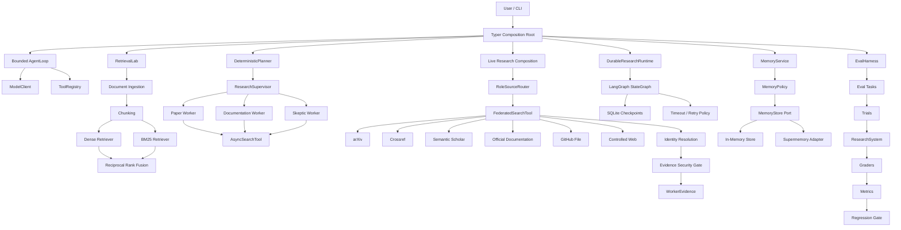

# Research CLI Agent — Engineering and Architecture Guide

## Purpose

This document explains the engineering ideas behind the Research CLI Agent.

It is not merely a list of files. Its purpose is to help a future maintainer answer:

- Why does this component exist?
- What contract does it expose?
- What assumptions does it make?
- What invariants must remain true?
- What other components must change if this component changes?
- What failure modes does it handle?
- What failure modes does it not handle?

Read this document before making architectural changes.

---

# 1. The central engineering thesis

The central principle of this project is:

> The model may propose an action, but application code owns execution authority.

An LLM is useful for:

- interpreting intent;
- proposing plans;
- selecting tools;
- generating search queries;
- summarizing evidence;
- producing structured drafts.

An LLM should not independently control:

- whether a tool exists;
- whether arguments are valid;
- how many times a tool may run;
- whether a side effect is authorized;
- whether a retry is safe;
- whether evidence is trustworthy;
- whether memory should be persisted;
- when a workflow should terminate.

Those responsibilities belong to deterministic application code.

This leads to the fundamental architecture:

```text
probabilistic proposal
        ↓
typed parsing
        ↓
deterministic validation
        ↓
policy and budget enforcement
        ↓
controlled execution
        ↓
typed observation
        ↓
trace, evaluation, or next proposal
```

---

# 2. Essential terminology

## 2.1 Agent

An agent is a system that repeatedly observes state, proposes an action, receives an observation, and continues until it reaches a terminal condition.

A minimal agent loop is:

```text
state
  ↓
model decision
  ├── tool call → runtime executes → observation → next decision
  └── final answer → terminate
```

The model alone is not the agent. The model is one decision-making component inside the agent system.

## 2.2 Runtime

The runtime is the deterministic execution authority.

It owns:

- state transitions;
- tool lookup;
- argument validation;
- step limits;
- tool budgets;
- timeouts;
- retries;
- cancellation;
- trace generation;
- terminal conditions.

In this project, `AgentLoop`, `SpecialistWorker`, `ResearchSupervisor`, and `DurableResearchRuntime` are runtime components at different abstraction levels.

## 2.3 Harness

A harness surrounds a system so it can be exercised and measured consistently.

An evaluation harness owns:

- tasks;
- repeated trials;
- grader execution;
- artifact collection;
- metric aggregation;
- baseline comparison;
- regression decisions.

A runtime performs the work. A harness evaluates the runtime performing that work.

## 2.4 Workflow

A workflow is a mostly predefined sequence or graph of operations.

For example:

```text
plan → retrieve → verify → synthesize
```

The application decides the control flow.

## 2.5 Agentic workflow

An agentic workflow contains one or more points where a model or decision component chooses what should happen next.

The runtime still restricts the available choices.

## 2.6 Orchestration

Orchestration coordinates multiple tasks or agents.

It handles:

- task decomposition;
- worker assignment;
- parallel execution;
- concurrency limits;
- result aggregation;
- partial failure;
- cancellation;
- stable ordering.

## 2.7 RAG

Retrieval-Augmented Generation separates evidence retrieval from answer generation.

```text
query
  ↓
retrieve relevant evidence
  ↓
compose bounded context
  ↓
generate answer from evidence
  ↓
verify citations and evaluate
```

Retrieval does not guarantee truth. Generation does not guarantee faithfulness. Each layer requires separate evaluation.

## 2.8 Memory

Memory is information intentionally persisted beyond the current execution.

It is different from:

- working messages;
- retrieved evidence;
- checkpoints;
- model context;
- application logs.

---

# 3. Complete system architecture



---

# 4. End-to-end execution flows

## 4.1 Minimal agent flow

```text
CLI query
  ↓
AgentLoop creates initial user Message
  ↓
ModelClient.decide(messages, tool specs)
  ↓
ToolCallDecision
  ↓
ToolRegistry checks tool name
  ↓
Tool validates arguments with Pydantic
  ↓
Tool executes
  ↓
Tool observation becomes a Message
  ↓
ModelClient decides again
  ↓
FinalDecision
  ↓
AgentResult with answer, messages, trace, and steps
```

If no final answer appears before `max_steps`, the runtime raises `StepLimitExceeded`.

## 4.2 Local retrieval flow

```text
corpus directory
  ↓
load_documents
  ↓
ResearchDocument values
  ↓
WordWindowChunker
  ↓
Chunk values
  ├── SentenceTransformerEmbedder → DenseRetriever
  └── tokenization → BM25Retriever
                  ↓
           HybridRetriever
                  ↓
        ranked SearchHit values
                  ↓
       resolve hit back to Chunk
```

## 4.3 Multi-agent research flow

```text
research question
  ↓
DeterministicPlanner
  ↓
ResearchPlan
  ├── papers assignment
  ├── documentation_code assignment
  └── skeptic assignment
  ↓
ResearchSupervisor
  ↓
bounded concurrent workers
  ↓
each SpecialistWorker:
    decide → search → observe → finish
  ↓
ResearchRun
```

## 4.4 Durable execution flow

```text
run_id + ResearchPlan
  ↓
normalize run ID
  ↓
calculate plan fingerprint
  ↓
load SQLite checkpoint
  ├── no checkpoint → create initial state
  └── checkpoint exists → verify fingerprint
  ↓
three parallel graph branches
  ↓
attempt worker under timeout
  ├── retryable → backoff → retry
  └── terminal → role done
  ↓
barrier waits for all three roles
  ↓
deterministic partial synthesis
  ↓
materialize DurableResearchRun
```

## 4.5 Memory flow

```text
MemoryCandidate
  ↓
MemoryPolicy.approve
  ├── rejected → MemoryPolicyRejected
  └── accepted → ApprovedMemory
  ↓
MemoryStore.add
  ↓
MemoryWriteReceipt
```

Recall:

```text
user_id + semantic query
  ↓
MemoryStore.search
  ↓
provider response normalization
  ↓
ownership validation
  ↓
deduplication
  ↓
ranked MemoryHit values
```

## 4.6 Live external research flow

```text
--prompt
  ↓
load administrator-owned allowlist
  ↓
create shared bounded AsyncClient
  ↓
construct source adapters
  ↓
RoleSourceRouter
  ├── papers → arXiv + Crossref + Semantic Scholar
  ├── documentation_code → docs + GitHub + controlled web
  └── skeptic → combined sources
  ↓
FederatedSearchTool fans out concurrently
  ↓
partial provider failures are isolated
  ↓
security screening
  ↓
canonical identity resolution
  ↓
cross-provider deduplication
  ↓
WorkerEvidence
  ↓
SpecialistWorker and ResearchSupervisor
```

## 4.7 Evaluation flow

```text
versioned EvalSuite
  ↓
each EvalTask
  ↓
N isolated trials
  ↓
ResearchSystem.run
  ↓
SystemOutput
  ↓
independent graders
  ↓
TrialArtifact
  ↓
aggregate metrics
  ↓
absolute and baseline-relative regression gates
  ↓
report.json + summary.md + trajectories.jsonl
```

---

# 5. Cross-cutting design principles

## 5.1 Dependency inversion

High-level business logic depends on interfaces, not provider implementations.

Examples:

- `AgentLoop` depends on `ModelClient`, not Gemini.
- `DenseRetriever` depends on `Embedder`, not Sentence Transformers.
- `MemoryService` depends on `MemoryStore`, not Supermemory.
- `SpecialistWorker` depends on `WorkerDecider` and `AsyncSearchTool`.
- `EvalHarness` depends on `ResearchSystem` and `Grader`.
- Gemini synthesis depends on `StructuredReportGenerator`.

This makes providers replaceable and tests deterministic.

## 5.2 Ports and adapters

A port is an application-owned interface.

An adapter translates a provider or implementation into that interface.

Examples:

| Port | Adapter |
|---|---|
| `ModelClient` | `DemoModel`, future Gemini/OpenAI model |
| `Tool` | `WordCountTool` |
| `Embedder` | `SentenceTransformerEmbedder` |
| `MemoryStore` | `InMemoryMemoryStore`, `SupermemoryStore` |
| `EvidenceSource` | arXiv, Crossref, Semantic Scholar, docs, GitHub |
| `ResearchSystem` | deterministic system, Gemini synthesis system |

Provider SDK types should not leak deep into application logic.

## 5.3 Typed boundaries

Untrusted data should become typed values near the boundary.

Examples:

- tool arguments become Pydantic input models;
- provider JSON becomes provider response models;
- graph dictionaries become `WorkerResult`;
- model JSON becomes `GeneratedSynthesis`;
- evaluation JSON becomes `EvalSuite`.

A loose `dict[str, Any]` is acceptable at an external serialization boundary. It should not remain loose throughout business logic.

## 5.4 Immutable value objects

Most domain models are frozen.

This prevents accidental mutation of values whose identity or checksum was calculated earlier.

Examples:

- documents;
- chunks;
- evidence;
- plans;
- worker results;
- evaluation artifacts;
- approved memories.

## 5.5 Determinism beneath probabilistic components

The infrastructure remains deterministic wherever possible:

- stable IDs;
- stable sorting;
- explicit tie-breakers;
- fixed planner roles;
- bounded budgets;
- deterministic tests;
- versioned datasets;
- canonical JSON fingerprints.

This allows model variability to be measured instead of confused with infrastructure variability.

## 5.6 Validate before side effects

Validation happens before external execution.

Examples:

- tool schemas before invocation;
- worker budgets before model/tool calls;
- URL policy before HTTP;
- memory policy before persistence;
- run fingerprint before checkpoint resume;
- retry authorization before another attempt.

## 5.7 Fail visibly

The system avoids silent loss.

Examples:

- unreadable files generate warnings;
- failed workers return error codes;
- partial durable runs are labelled `PARTIAL`;
- missing token usage remains `None`;
- regression failures contain explicit reasons;
- quarantined evidence remains auditable.

---

# 6. Root package: `src/research_agent`

## `domain.py`

Defines contracts for the minimal agent runtime:

- `Message`
- `ToolSpec`
- `ToolCallDecision`
- `FinalDecision`
- `Decision`
- `TraceEvent`
- `AgentResult`

`Decision` is a discriminated union using the `kind` field.

That allows a parser to distinguish:

```json
{"kind": "tool_call", "tool_name": "word_count", "arguments": {...}}
```

from:

```json
{"kind": "final", "answer": "..."}
```

## `ports.py`

Defines:

- `ModelClient`
- `Tool`

These are structural protocols. An implementation does not need to inherit from them. It only needs the required methods and properties.

## `loop.py`

Contains `AgentLoop`.

Responsibilities:

- create working message state;
- call the model;
- interpret typed decisions;
- execute approved tools through the registry;
- append observations;
- create trace events;
- terminate on a final decision;
- enforce `max_steps`.

It does not know which model vendor or tool implementation is used.

## `tools.py`

Contains:

- `WordCountInput`
- `WordCountTool`
- `ToolRegistry`

The registry is an allowlist. A model cannot invoke arbitrary Python functions by inventing a name.

The tool validates its own argument schema because the tool is the authority on what it accepts.

## `errors.py`

Contains application-level errors such as:

- unknown tool;
- step limit exceeded.

Typed errors allow CLI and higher runtime layers to translate failures into appropriate user-visible outcomes.

## `context.py`

Contains deterministic context composition:

- system instructions;
- current query;
- retrieved evidence;
- recent working messages;
- durable memories;
- category budgets;
- total context budget;
- cross-category deduplication.

Important trust labels include:

```text
retrieved_evidence: untrusted-data
long_term_memory: personal-context-not-evidence
```

This distinction prevents memory from silently becoming factual evidence.

The current whitespace counter is an approximation. A production model integration should inject the selected model’s real tokenizer.

## `models/demo.py`

`DemoModel` is a deterministic stand-in for an LLM.

It proves the runtime without requiring:

- internet;
- API credentials;
- provider availability;
- nondeterministic model output.

It first proposes `word_count`, then converts the observation into a final answer.

## `cli.py`

The CLI is the application composition root.

It:

- parses user input;
- reads environment variables;
- constructs providers and application services;
- owns resource lifecycles;
- invokes runtimes;
- renders results;
- maps application exceptions to exit codes.

Business logic should not move into the CLI.

---

# 7. Retrieval and RAG package

## 7.1 `retrieval/models.py`

Defines shared retrieval contracts:

- `ResearchDocument`
- `Chunk`
- `SearchHit`
- `LabeledQuery`

These models are owned by the retrieval domain, not by an individual pipeline stage.

### Stable document identity

A document ID is derived from:

```text
relative source path + content checksum
```

Using a corpus-relative path means moving the entire corpus root does not change document IDs.

Changing document content changes its checksum and therefore its ID.

### Stable chunk identity

A chunk ID currently uses:

```text
document ID + chunk index
```

This is stable when the document and chunking algorithm remain unchanged.

Important limitation:

> Changing `window_size`, overlap, tokenizer, or chunking strategy can change chunk text while retaining the same `(doc_id, chunk_index)` identity.

A stronger future design should include a chunker version, boundaries, or chunk-text checksum in the chunk ID.

## 7.2 `retrieval/ingestion.py`

The ingestion stage owns:

- filesystem traversal;
- format allowlisting;
- UTF-8 reading;
- whitespace normalization;
- empty/unreadable-file handling;
- conversion to `ResearchDocument`.

It deliberately does not perform chunking, embeddings, or retrieval.

To add PDF support, create a dedicated parser or loader. Do not add PDF-specific layout logic throughout the generic ingestion loop.

## 7.3 `retrieval/chunking.py`

`WordWindowChunker` performs a pure in-memory transformation:

```text
ResearchDocument → list[Chunk]
```

For:

```text
window_size = 120
overlap = 20
```

the stride is:

```text
stride = 120 - 20 = 100
```

Overlap reduces boundary loss. A concept split at the end of one chunk appears again near the beginning of the next.

Trade-offs:

- larger chunks provide more context but may dilute relevance;
- smaller chunks increase precision but may lose context;
- more overlap improves continuity but increases storage and duplicate retrieval;
- word windows are deterministic but not structure-aware.

## 7.4 `retrieval/ports.py`

Defines:

- `Embedder`
- `Retriever`
- `FloatVector`
- `FloatMatrix`

Dense retrieval depends on the `Embedder` interface, not directly on Sentence Transformers.

## 7.5 `retrieval/embeddings.py`

`SentenceTransformerEmbedder` adapts a local Sentence Transformers model to the application’s embedding port.

The default model is:

```text
sentence-transformers/all-MiniLM-L6-v2
```

Document and query embeddings have separate methods because some modern models use different instructions or encoders for query and document representations.

An embedding is a numeric representation of meaning:

```text
text → vector in R^d
```

Semantically related text should appear close in vector space.

## 7.6 `retrieval/dense.py`

The dense retriever:

1. embeds every chunk;
2. validates matrix shape;
3. normalizes document vectors;
4. embeds and normalizes the query;
5. calculates similarity with matrix multiplication;
6. sorts by descending similarity;
7. uses `chunk_id` as a deterministic tie-breaker.

For normalized vectors:

```text
cosine_similarity(q, d) = q · d
```

Dense retrieval is strong for:

- paraphrases;
- semantic similarity;
- conceptual matching;
- vocabulary mismatch.

It can be weak for:

- exact identifiers;
- rare names;
- code symbols;
- error messages;
- version numbers.

## 7.7 `retrieval/bm25.py`

BM25 is a lexical ranking algorithm.

Its simplified scoring contribution is:

```text
IDF(term) ×
TF × (k1 + 1)
─────────────────────────────────────────────
TF + k1 × (1 - b + b × document_length / average_length)
```

BM25 rewards:

- query-term occurrence;
- rare terms;
- repeated terms with saturation;
- appropriate document length.

It is strong for exact tokens and rare terminology.

## 7.8 `retrieval/hybrid.py`

Dense and BM25 scores cannot be added directly because they use unrelated scales.

The project uses Reciprocal Rank Fusion:

```text
RRF(document) = Σ 1 / (k + rank)
```

With `k = 60`, a document receives credit based on its position in each retriever rather than its raw score.

`candidate_multiplier` retrieves a larger candidate pool from each child retriever before final fusion.

Hybrid retrieval combines:

- semantic recall from dense retrieval;
- lexical precision from BM25.

## 7.9 `retrieval/lab.py`

`RetrievalLab` is the local retrieval composition root.

It constructs and owns:

- ingested documents;
- chunks;
- dense retriever;
- BM25 retriever;
- hybrid retriever;
- chunk lookup map.

Consumers ask the lab for a retriever or perform a search without knowing how the index was constructed.

## 7.10 `retrieval/evaluation.py`

The retrieval evaluator measures Recall@k:

```text
Recall@k =
|retrieved top-k ∩ relevant chunk IDs|
───────────────────────────────────────
|relevant chunk IDs|
```

Recall measures whether relevant evidence was retrieved.

It does not measure:

- ranking quality beyond k;
- factual correctness;
- answer completeness;
- citation faithfulness;
- generation quality.

Useful future metrics include:

- precision@k;
- mean reciprocal rank;
- nDCG;
- answer-level groundedness;
- retrieval latency.

---

# 8. Memory package

## 8.1 Memory architecture

```text
untrusted MemoryCandidate
        ↓
deterministic MemoryPolicy
        ↓
ApprovedMemory
        ↓
MemoryStore port
        ├── InMemoryMemoryStore
        └── SupermemoryStore
```

Memory writes are explicit. The agent does not automatically persist everything it sees.

## 8.2 `memory/models.py`

Defines:

- `MemoryCandidate`
- `ApprovedMemory`
- `MemoryWriteReceipt`
- `MemoryHit`
- `MemoryKind`

A candidate is untrusted. An approved memory has passed policy.

## 8.3 `memory/policy.py`

The policy:

- normalizes content;
- validates user and session identity;
- allowlists memory kinds;
- rejects empty content;
- limits content length;
- scans for obvious secrets;
- creates stable logical memory IDs.

The stable memory ID is derived from:

```text
user ID + memory kind + normalized content
```

The owner hash embedded in the logical ID allows an internal ownership consistency check.

This is not authentication. Authentication belongs at an API or user-session boundary.

## 8.4 `memory/ports.py`

`MemoryStore` defines three operations:

- `add`
- `search`
- `delete`

Application code does not depend on the Supermemory SDK directly.

## 8.5 `memory/service.py`

`MemoryService` coordinates policy and storage.

It is intentionally small:

```text
remember = approve then add
recall = search
forget = delete
```

The service is the correct place for future cross-cutting memory behavior such as:

- audit logging;
- user authorization;
- retention policies;
- write confirmation;
- provider metrics.

## 8.6 `memory/in_memory.py`

Provides a deterministic store for tests and local demonstrations.

Recall uses lexical overlap rather than embeddings. That is acceptable because the purpose of this adapter is deterministic behavior, not production semantic search quality.

## 8.7 `memory/supermemory.py`

The Supermemory adapter translates between application models and provider SDK responses.

It deliberately confines `Any` to the SDK boundary because generated SDK response classes may change.

Important behavior:

- user scope becomes a hashed container tag;
- logical IDs and metadata are sent to the provider;
- v4 hybrid search is used;
- a bounded candidate pool is retrieved;
- results are validated;
- source chunks are preferred over extracted memory summaries;
- duplicate provider representations collapse into one logical memory;
- ranking is deterministic;
- deletion checks logical ownership first.

## 8.8 Memory is not evidence

A remembered user preference may personalize an answer:

```text
The user prefers concise reports.
```

It should not support an external factual claim:

```text
Model X has a 200k context window.
```

Long-term memory is personal context. Retrieved documents are evidence. They must remain separately labelled.

---

# 9. Orchestration package

## 9.1 `orchestration/models.py`

Defines the contracts for multi-worker execution:

- roles;
- statuses;
- budgets;
- assignments;
- plans;
- evidence;
- decisions;
- observations;
- usage;
- traces;
- results.

The `WorkerEvidence` model is the common evidence currency for local and external sources.

## 9.2 `orchestration/planner.py`

The deterministic planner creates three roles:

- `papers`
- `documentation_code`
- `skeptic`

This is controlled decomposition, not model-generated delegation.

Advantages:

- predictable cost;
- predictable concurrency;
- easy testing;
- stable evaluation;
- clear role authority.

Limitation:

- the decomposition cannot adapt to every query.

A future model planner should still return a validated `ResearchPlan` and remain subject to `ResearchBudget`.

## 9.3 `orchestration/ports.py`

Defines:

- `WorkerDecider`
- `AsyncSearchTool`
- `ResearchWorker`

A worker runtime can therefore use a deterministic decider today and a structured LLM decider later without changing supervisor logic.

## 9.4 `orchestration/worker.py`

### `DeterministicWorkerDecider`

The current policy performs one search and then finishes using the highest-ranked eligible evidence.

It is intentionally simple. Its purpose is to exercise runtime architecture without model nondeterminism.

### `LocalRetrievalTool`

The local retrieval system is synchronous and potentially CPU-heavy.

`async def` alone does not make synchronous computation concurrent.

Therefore the adapter uses:

```python
await asyncio.to_thread(...)
```

A lock serializes access to the shared Sentence Transformers model until thread safety and useful concurrent performance are established.

### `SpecialistWorker`

The worker loop owns:

- decision count;
- tool-call count;
- observations;
- accumulated evidence;
- worker trace;
- status construction.

Budgets are checked before invoking dependencies.

This prevents “one last call” from exceeding the configured limit.

Failures become a `WorkerResult(status="failed")`, allowing the supervisor to preserve sibling results.

## 9.5 `orchestration/supervisor.py`

The supervisor:

- validates the plan before starting work;
- ensures a worker exists for every role;
- uses a semaphore for concurrency;
- uses a `TaskGroup` for structured concurrency;
- tracks active and peak workers;
- preserves plan order;
- converts ordinary worker exceptions into failed results;
- propagates cancellation.

### Why preserve plan order?

Completion order varies with network and scheduling conditions.

Returning completion order would make output nondeterministic.

The supervisor preallocates a result slot for every plan index:

```text
result[index] = completed worker result
```

This allows concurrent execution with deterministic output order.

### Why failure becomes data but cancellation propagates

A worker failure is a domain outcome:

```text
papers completed
documentation failed
skeptic completed
```

Cancellation is orchestration control:

```text
the caller no longer wants this run
```

Converting cancellation into an ordinary failure would prevent proper shutdown and waste resources.

### `max_workers` vs `max_concurrency`

`max_workers` limits the total number of assignments admitted into the run.

`max_concurrency` limits how many admitted workers may execute simultaneously.

Example:

```text
10 assignments
max_workers = 10
max_concurrency = 3
```

All ten assignments are allowed, but only three run at once.

---

# 10. Durable package

## 10.1 Why durability matters

Suppose:

```text
papers completes
documentation completes
skeptic crashes
process restarts
```

A non-durable system may repeat all three workers.

A durable system should resume only the unfinished branch.

## 10.2 `durable/models.py`

`DurableResearchState` contains primitive, serializable state:

- run ID;
- serialized plan;
- plan fingerprint;
- per-role results;
- attempt counts;
- retry routes;
- attempt records;
- run status;
- final report.

Parallel graph nodes return partial dictionary updates.

`merge_mappings` acts as a reducer so independent role branches can safely merge updates by key.

### Plan fingerprint

The plan is serialized into canonical JSON and hashed.

A run ID cannot be reused with a different plan.

Without this check, an old checkpoint might silently contaminate a new request.

## 10.3 `durable/policy.py`

`WorkerExecutionPolicy` owns:

- maximum attempts;
- per-attempt timeout;
- retryable error codes;
- exponential backoff;
- maximum backoff;
- jitter.

`max_attempts` includes the initial attempt.

```text
max_attempts = 2
→ one initial attempt + at most one retry
```

Retry authorization considers:

- attempts used;
- worker status;
- error code.

It does not blindly retry every failure.

## 10.4 `durable/graph.py`

Each worker role receives its own branch:

```text
START
  ├── papers_attempt
  │      ├── retry → papers_backoff → papers_attempt
  │      └── done → papers_done
  ├── documentation_attempt
  │      ├── retry → documentation_backoff → documentation_attempt
  │      └── done → documentation_done
  └── skeptic_attempt
         ├── retry → skeptic_backoff → skeptic_attempt
         └── done → skeptic_done
```

The three done nodes form a barrier before synthesis:

```text
[papers_done, documentation_done, skeptic_done]
                         ↓
                    synthesize
                         ↓
                        END
```

The attempt node:

1. increments the attempt;
2. executes under `asyncio.timeout`;
3. converts timeout into a typed result;
4. validates worker/result identity;
5. asks the retry policy for authorization;
6. calculates backoff;
7. writes an attempt record;
8. stores a final result only when retrying has stopped.

## 10.5 `durable/runtime.py`

The runtime owns:

- SQLite checkpointer lifecycle;
- LangGraph thread configuration;
- create-versus-resume behavior;
- plan-fingerprint validation;
- durable graph invocation;
- final snapshot validation;
- conversion back into `DurableResearchRun`.

`durability="sync"` prioritizes checkpoint persistence before progressing.

The runtime refuses to materialize:

- a state still marked `running`;
- a graph with unfinished nodes;
- missing role results;
- missing attempt counts;
- missing attempt records;
- an empty final report.

## 10.6 `durable/synthesis.py`

`classify_run_status` returns:

- `completed` if every worker completed;
- `failed` if no worker completed;
- `partial` otherwise.

The deterministic synthesizer preserves worker outcomes and warns when evidence is incomplete.

It does not pretend that two successful workers equal three successful workers.

---

# 11. External sources package

## 11.1 `sources/http.py`

`bounded_get` is the shared transport guard.

It enforces:

- HTTPS;
- explicit host allowlist;
- no trusted redirects;
- accepted content types;
- declared content-length limits;
- streamed byte limits;
- typed timeout, rate-limit, policy, and availability errors.

This is safer than allowing each adapter to implement HTTP differently.

## 11.2 `sources/adapters.py`

Contains adapters for:

- arXiv Atom metadata;
- official documentation pages;
- exact GitHub files.

The GitHub target includes:

- owner;
- repository;
- path;
- ref.

The ref should be an immutable commit or release tag when reproducibility matters.

## 11.3 `sources/scholarly.py`

Contains:

- Crossref adapter;
- Semantic Scholar adapter;
- private provider response schemas.

Provider JSON is parsed into provider-specific Pydantic models before it becomes application evidence.

This protects the rest of the application from provider schema details.

## 11.4 `sources/web.py`

The controlled-web adapter fetches one exact allowlisted page.

It removes:

- scripts;
- styles;
- navigation;
- forms;
- iframes;
- footer and aside noise.

It extracts a query-relevant excerpt.

It is not a general search engine and does not discover arbitrary URLs.

## 11.5 `sources/evidence.py`

Creates normalized external `WorkerEvidence`.

It assigns:

- deterministic snapshot ID;
- provider;
- source type;
- scope;
- canonical URL;
- identifiers;
- provider chain.

## 11.6 `sources/identity.py`

Cross-provider deduplication uses the strongest available identity:

```text
DOI
  ↓ if absent
arXiv ID
  ↓ if absent
Semantic Scholar ID
  ↓ if absent
normalized title + year
  ↓ otherwise
snapshot identity
```

When duplicates are merged, the richer representation wins while provider lineage is retained.

Raw provider scores are not assumed comparable.

## 11.7 `sources/security.py`

The evidence security gate scans for obvious patterns such as:

- instruction overrides;
- role overrides;
- prompt exfiltration;
- secret exfiltration;
- tool-execution instructions.

It then:

- calculates a content hash;
- records risk flags;
- marks suspicious evidence ineligible for synthesis.

This is defense in depth, not a complete prompt-injection solution.

The strongest protection is architectural:

> External text is data. It never receives tool or policy authority.

## 11.8 `sources/federation.py`

The federated tool:

1. calls independent sources concurrently;
2. converts provider `SourceError` failures into isolated failed batches;
3. continues if siblings succeed;
4. fails only when all configured sources fail;
5. security-screens every item;
6. assigns canonical identity;
7. merges duplicates;
8. re-ranks the final bounded output.

One provider outage therefore does not erase valid sibling evidence.

## 11.9 `sources/routing.py`

`RoleSourceRouter` enforces source authority by worker role.

It validates that every required role has at least one source.

The model does not choose arbitrary providers.

## 11.10 `sources/live.py`

This is the live-research composition root.

It:

- validates administrator-owned targets;
- requires HTTPS;
- rejects credentials embedded in URLs;
- rejects URL fragments;
- builds paper and engineering source sets;
- assigns sources to roles;
- creates workers;
- runs the bounded supervisor.

Scholarly sources search by query.

Documentation, GitHub, and controlled-web sources use exact administrator-selected targets.

## 11.11 `sources/ledger.py`

The claim ledger verifies citation mechanics.

It checks:

- cited evidence exists;
- evidence content hash still matches;
- quoted text appears exactly in evidence;
- evidence is eligible for synthesis.

Possible statuses:

- `citation_verified`
- `unsupported`
- `invalid_citation`
- `quarantined_source`

Important:

> Citation integrity is not semantic entailment.

A quote may exist in a source without logically proving the claim. Semantic support requires another grader, human review, or a carefully evaluated entailment model.

---

# 12. Evaluation package

## 12.1 Runtime versus harness

The research system produces an output.

The harness repeatedly invokes that system under controlled tasks and measures it.

```text
ResearchSystem = system under test
EvalHarness = experimental apparatus
Grader = independent judgment
Metric = aggregate measurement
Regression gate = release decision
```

## 12.2 `evaluation/models.py`

Defines:

- `EvalTask`
- `EvalSuite`
- `UsageMetrics`
- `TrajectoryEvent`
- generated claims;
- cited reports;
- `SystemOutput`
- `GradeResult`
- `TrialArtifact`
- `EvalSummary`
- `EvalBaseline`
- `RegressionDecision`
- `EvalReport`

The dataset and schema are versioned.

Changing task meaning should change the dataset version.

## 12.3 `evaluation/ports.py`

Defines:

- `ResearchSystem`
- `Grader`
- `StructuredReportGenerator`

This allows the same harness to evaluate deterministic and Gemini-backed systems.

## 12.4 `evaluation/systems.py`

### Deterministic profile

The deterministic research system:

1. creates the plan;
2. runs local multi-worker retrieval;
3. deduplicates evidence;
4. produces deterministic claims;
5. verifies citations;
6. converts traces into trajectory events;
7. records zero model cost.

### Gemini profile

The Gemini system wraps the deterministic base system.

Retrieval remains unchanged. Gemini is used only for synthesis.

The runtime then:

1. filters to eligible evidence;
2. requests structured claims and citations;
3. verifies every proposed citation;
4. accepts verified claims;
5. rejects invalid claims;
6. records usage, latency, and nominal price.

The model does not get the final authority to declare its own citations valid.

## 12.5 `evaluation/harness.py`

For every task and trial, the harness:

1. creates a stable trial ID;
2. invokes the research system;
3. runs all graders;
4. passes only if every hard grader passes;
5. converts system exceptions into failed artifacts;
6. preserves cancellation;
7. calculates a functional digest;
8. aggregates metrics;
9. evaluates regression thresholds.

Trials run sequentially to:

- avoid API bursts;
- reduce local resource contention;
- make latency comparisons less noisy.

## 12.6 `evaluation/graders.py`

### Hard graders

Hard graders affect trial pass/fail:

- completion status;
- budget compliance;
- source coverage;
- citation integrity;
- quarantined-evidence exclusion;
- trajectory invariants.

### Soft grader

Expected-term coverage is a weak lexical signal.

It should not be treated as semantic truth.

## 12.7 `evaluation/metrics.py`

Important metrics:

### Trial pass rate

```text
passed trials / total trials
```

Measures total successful attempts.

### Consistent task rate

```text
tasks where every trial passed / total tasks
```

Measures reliability across repeated trials.

### Pass@k

```text
tasks with at least one successful trial / total tasks
```

Measures whether repeated attempts can produce at least one success.

A system can have high Pass@k but poor consistency.

### p95 latency

The 95th percentile captures tail latency better than the mean.

Users often experience slow outliers, not average behavior.

## 12.8 `evaluation/pricing.py`

A versioned price card converts token counts into nominal micro-USD.

It is an estimate, not an invoice.

If token usage is unavailable, cost remains unavailable rather than being silently treated as zero.

## 12.9 `evaluation/regression.py`

Regression gates support:

- absolute quality floors;
- maximum latency;
- maximum cost;
- maximum drop from a matching baseline.

A baseline from a different dataset version is rejected.

## 12.10 `evaluation/reporting.py`

Produces:

- machine-readable JSON;
- human-readable Markdown;
- trajectory JSONL.

Machine and human outputs serve different consumers and should both be retained.

---

# 13. API design principles used in the project

## 13.1 Accept domain values, not provider responses

Good:

```python
def grade(task: EvalTask, output: SystemOutput) -> GradeResult:
    ...
```

Weak:

```python
def grade(task: dict, provider_response: Any) -> dict:
    ...
```

Provider translation should happen at the boundary.

## 13.2 Return typed results

A typed `WorkerResult` exposes:

- status;
- evidence;
- usage;
- error code;
- timestamps;
- trace.

A string like `"worker failed"` is not sufficient for automation or evaluation.

## 13.3 Make authority explicit

Examples:

- `ToolRegistry` owns tool authority;
- `MemoryPolicy` owns persistence authority;
- `ResearchBudget` owns worker authority;
- `WorkerExecutionPolicy` owns retry authority;
- `RoleSourceRouter` owns source authority;
- regression thresholds own release authority.

## 13.4 Separate configuration from behavior

Configuration includes:

- budgets;
- retry thresholds;
- source allowlists;
- model name;
- price cards;
- evaluation datasets.

Behavior lives in runtime components.

## 13.5 Prefer explicit lifecycle ownership

The CLI creates and closes:

- HTTP clients;
- provider clients;
- checkpoint savers;
- application services.

Long-lived resources should not be created invisibly inside arbitrary business functions.

---

# 14. Failure and recovery principles

## 14.1 Tool timeout

A timeout means:

```text
the caller did not receive a result before its deadline
```

It does not prove:

```text
the remote operation never happened
```

For read-only search, retry is usually safe.

For side effects such as appointment creation or payment, blind retry may duplicate the action.

Use:

- idempotency keys;
- operation IDs;
- status reconciliation;
- at-most-once or effectively-once semantics;
- compensation where necessary.

## 14.2 Partial workflow failure

Preserve:

- successful sibling results;
- attempt records;
- failure codes;
- checkpoints;
- incomplete status.

Never silently report a partial run as complete.

## 14.3 Retry policy

Retry transient failures such as:

- timeout;
- rate limit;
- temporary unavailability.

Do not retry deterministic failures such as:

- schema validation;
- policy rejection;
- unsupported tool;
- malformed configuration;
- authentication failure without credential change.

## 14.4 Backoff and jitter

Exponential backoff reduces repeated pressure:

```text
delay_n = min(max_delay, initial_delay × 2^(n-1))
```

Jitter prevents many workers from retrying at exactly the same time.

## 14.5 Cancellation

Cancellation must propagate.

Suppressing cancellation can:

- delay shutdown;
- leak resources;
- continue unwanted side effects;
- make structured concurrency unreliable.

---

# 15. Testing architecture

## 15.1 Unit tests

Test pure or bounded components:

- schemas;
- policies;
- chunking;
- scoring;
- fusion;
- ID stability;
- retry decisions;
- graders;
- metric calculations.

## 15.2 Contract tests

Verify adapters satisfy application ports.

Examples:

- fake embedder with `DenseRetriever`;
- fake memory store with `MemoryService`;
- fake research system with `EvalHarness`;
- mocked HTTP transport with source adapters.

## 15.3 Integration tests

Exercise multiple real internal layers while replacing only external systems.

Examples:

- live research with `httpx.MockTransport`;
- CLI with patched application boundary;
- durable graph with temporary SQLite;
- complete deterministic evaluation.

## 15.4 Live tests

Live tests should be opt-in because they depend on:

- network;
- quotas;
- provider schemas;
- changing external data;
- credentials.

They validate integration health, not deterministic correctness.

## 15.5 Test quality principle

Every test should answer:

> What realistic production bug would cause this test to fail?

Avoid tests that merely assert internal implementation details.

---

# 16. Safe extension playbook

## Add a new model provider

1. Implement `ModelClient` or `StructuredReportGenerator`.
2. Parse provider output immediately into application models.
3. Translate provider errors.
4. record token usage and latency;
5. add deterministic adapter tests;
6. add opt-in live tests;
7. keep `AgentLoop` or `EvalHarness` unchanged.

## Add a new tool

1. Define a Pydantic input model.
2. implement `Tool.spec`;
3. implement `Tool.invoke`;
4. register it explicitly;
5. test valid and invalid arguments;
6. decide whether it has side effects;
7. add timeout, authorization, and idempotency if needed.

## Add a new embedding provider

1. Implement `Embedder`.
2. preserve document/query separation.
3. return `float32` vectors.
4. validate dimension consistency.
5. test zero vectors and shape errors.
6. rerun retrieval evaluation.

## Change chunking

1. create new chunker tests;
2. evaluate Recall@k;
3. decide how IDs should be versioned;
4. regenerate labeled chunk IDs if necessary;
5. rebuild indexes;
6. compare latency and storage;
7. document the migration.

Do not change chunking silently while retaining incompatible evaluation labels.

## Add a new retriever

1. Implement `Retriever`.
2. return ranked `SearchHit` values.
3. define deterministic tie-breaking.
4. add it to `RetrievalMode` and `RetrievalLab`.
5. add retrieval evaluation.
6. decide how it participates in fusion.

## Add a new worker role

This is a cross-cutting change.

Update:

- `WorkerRole`;
- planner;
- worker map;
- source routing;
- `REQUIRED_ROLES`;
- durable graph;
- initial-state validation;
- synthesis;
- CLI rendering;
- evaluation tasks;
- tests.

## Add a new external provider

1. implement `EvidenceSource`;
2. use `bounded_get`;
3. parse into provider-specific schemas;
4. normalize into `WorkerEvidence`;
5. preserve canonical URL and identifiers;
6. add source routing;
7. security-screen evidence;
8. add mock transport tests;
9. add opt-in live tests;
10. update source-coverage graders if required.

## Add a memory kind

Update:

- `MemoryKind`;
- policy allowlist;
- Supermemory allowlist;
- CLI enum;
- tests;
- documentation.

## Change durable state

Treat it as a schema migration.

Existing SQLite checkpoints may contain the old structure.

Options include:

- state versioning;
- checkpoint migration;
- rejecting incompatible checkpoints;
- starting a new checkpoint database.

## Add a grader

1. decide whether it is hard or soft;
2. implement `Grader`;
3. return a bounded score and explanation;
4. add deterministic tests;
5. add it to `default_graders`;
6. assess whether baselines need regeneration.

## Change evaluation tasks

1. update the dataset;
2. increment `dataset_version`;
3. rerun deterministic evaluation;
4. inspect individual failures;
5. create a new baseline;
6. never compare incompatible dataset versions.

---

# 17. Current limitations and production improvements

## Retrieval

Current limitations:

- in-memory index rebuilt per process;
- no vector database;
- no incremental indexing;
- word-based chunks;
- no reranker;
- no query rewriting;
- chunk identity does not encode chunker configuration.

Potential improvements:

- persistent FAISS/Qdrant/Postgres index;
- document-version manifest;
- sentence-aware or semantic chunking;
- cross-encoder reranking;
- retrieval caching;
- Recall, precision, MRR, and nDCG dashboards.

## Agent reasoning

Current deterministic worker performs one search and uses the top eligible item.

Potential improvements:

- structured LLM worker decisions;
- query reformulation;
- evidence-gap analysis;
- source-specific queries;
- explicit stop criteria;
- contradiction detection.

## Live research

Current limitations:

- allowlisted pages are not general web search;
- source adapters may encounter schema changes;
- the live command is not itself checkpointed;
- partial source failures are isolated but not automatically retried there;
- provider rate limits require operational monitoring.

## Memory

Current limitations:

- secret detection is pattern based;
- ownership guard is not authentication;
- no retention/expiry policy;
- no user confirmation UI;
- no memory quality evaluation.

## Security

Current injection scanning is heuristic.

Future controls could include:

- content isolation;
- stronger HTML sanitization;
- policy models;
- provenance-aware prompting;
- human approval;
- restricted tool capabilities;
- network egress policy;
- secret redaction;
- adversarial evaluation suites.

## Evaluation

Current citation checks verify mechanics, not entailment.

Future graders could measure:

- claim entailment;
- answer completeness;
- contradiction;
- source quality;
- freshness;
- calibration;
- human preference;
- robustness under provider failure.

---

# 18. Glossary

**Adapter:** Translation layer between an external provider and an application-owned interface.

**Agent:** A runtime that iteratively chooses actions using observations and state.

**Artifact:** Persisted result of an evaluation trial.

**Backoff:** Delay before retrying a failed operation.

**Checkpoint:** Durable snapshot used to resume execution.

**Chunk:** Retrieval-sized segment of a document.

**Context:** Bounded information supplied to a model for one decision.

**Dense retrieval:** Semantic retrieval using vector similarity.

**Embedding:** Numeric representation of text meaning.

**Evidence:** Source-preserving information retrieved for a task.

**Grader:** Independent evaluator of a system output.

**Harness:** Infrastructure that repeatedly runs and measures a system.

**Idempotency:** Property that repeating an operation does not create additional effects.

**Memory:** Intentionally persisted information available across runs.

**Observation:** Structured result returned after an action.

**Orchestration:** Coordination of workers, tasks, resources, and failures.

**Port:** Application-owned provider-neutral interface.

**Provenance:** Information describing where evidence came from and how it was transformed.

**RAG:** Retrieval-Augmented Generation.

**Reciprocal Rank Fusion:** Rank-based combination of multiple retriever outputs.

**Runtime:** Deterministic authority that validates and executes proposed actions.

**State:** Information required to continue execution correctly.

**Structured concurrency:** Concurrency where child task lifetimes are scoped to a parent.

**Trace:** Observable sequence of execution events.

**Trial:** One isolated attempt at an evaluation task.

**Workflow:** Predefined sequence or graph of operations.

---

# 19. Final mental model

The complete project can be understood as five nested control systems:

```text
1. Tool runtime
   model proposal → validated tool execution

2. Worker runtime
   decision → search → observation → finish

3. Supervisor runtime
   plan → bounded concurrent workers → ordered results

4. Durable runtime
   checkpointed attempts → retry/backoff → resume → partial synthesis

5. Evaluation harness
   tasks → trials → graders → metrics → regression gate
```

RAG, memory, and live sources provide information to these runtimes, but none of them should independently control execution.

That is the central professional lesson of this project:

> Reliable agent engineering is less about making a model more autonomous and more about building explicit boundaries around uncertainty.