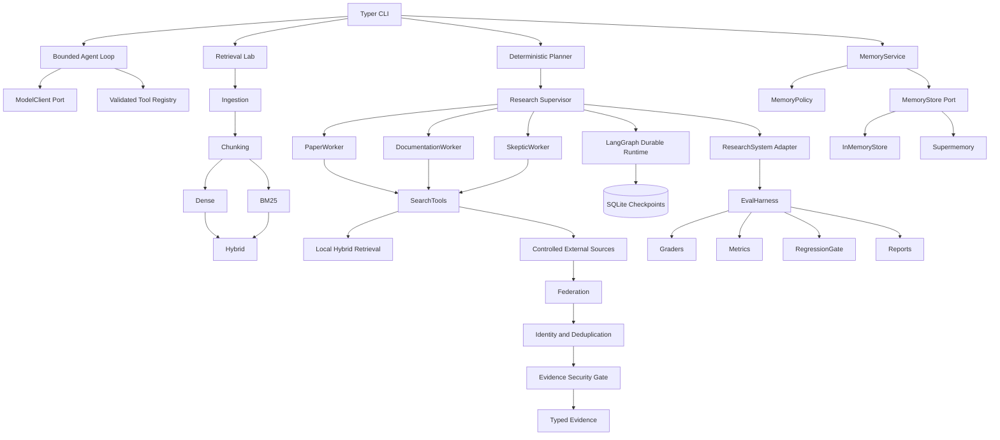

# Research Agent Engineering — Architecture and Maintenance Guide

## Purpose

This document explains the engineering principles, architecture, data flow, runtime behavior, retrieval system, memory system, orchestration, durable execution, external research, and evaluation harness implemented in this project.

It is intended to answer four questions:

1. What does each subsystem do?
2. Why was it designed this way?
3. What guarantees does it provide?
4. What must change when extending it?

This is a maintainer’s guide and learning textbook. It is not merely a command reference.

---

# 1. The central engineering principle

The most important principle in this project is:

> The model proposes actions; the application runtime owns authority.

An LLM may propose:

- a tool name;
- tool arguments;
- a search query;
- a plan;
- a final answer;
- claims and citations.

But the LLM must not directly control:

- whether a tool is authorized;
- whether its arguments are valid;
- how many times it may run;
- whether an external URL is trusted;
- whether a retry is allowed;
- whether content may enter long-term memory;
- whether a citation is valid;
- whether a result passes evaluation.

Those responsibilities belong to deterministic application code.

```text
probabilistic proposal
        ↓
typed parsing
        ↓
validation
        ↓
policy
        ↓
budget enforcement
        ↓
execution
        ↓
structured observation
        ↓
evaluation
```

This division is the difference between an LLM demo and an engineered agent runtime.

---

# 2. Core vocabulary

## 2.1 Agent

An agent is a system that repeatedly observes state, proposes an action, executes an authorized action, receives an observation, and decides whether to continue.

A minimal agent loop is:

```text
observe → decide → act → observe → decide → ... → terminate
```

The model alone is not the agent. The complete agent includes:

- model;
- runtime;
- tools;
- working state;
- policies;
- termination rules;
- traces;
- failure handling.

## 2.2 Runtime

The runtime is the deterministic software responsible for executing the agent safely.

It owns:

- model invocation;
- decision parsing;
- tool lookup;
- argument validation;
- budgets;
- timeouts;
- retries;
- state transitions;
- traces;
- termination.

The runtime is an authority boundary.

## 2.3 Harness

A harness is an outer control system that runs another system under controlled conditions.

An evaluation harness:

- selects tasks;
- creates isolated trials;
- invokes the system under test;
- collects outputs;
- applies graders;
- calculates metrics;
- writes artifacts;
- enforces regression gates.

The harness measures the runtime. It is not the runtime itself.

## 2.4 Orchestration

Orchestration coordinates multiple tasks or agents.

It decides:

- which workers exist;
- what each worker is responsible for;
- which work can run concurrently;
- how results are ordered;
- how partial failures are represented;
- when synthesis may begin.

## 2.5 Workflow

A workflow is an explicit graph or sequence of operations.

A workflow can be deterministic even if some nodes call probabilistic models.

```text
plan → retrieve → verify → synthesize
```

An agent differs because its next action may be selected dynamically from current state.

## 2.6 RAG

Retrieval-Augmented Generation, or RAG, is an architecture where external evidence is retrieved and supplied to a generator.

```text
query
  ↓
retriever
  ↓
ranked evidence
  ↓
context construction
  ↓
generator
  ↓
cited answer
```

Retrieval and generation are separate problems. Good retrieval does not guarantee a correct answer, and a capable model cannot answer reliably if relevant evidence was never retrieved.

## 2.7 Memory

Memory is information retained beyond the current immediate operation.

This project distinguishes:

- working state: messages and observations for the current run;
- retrieved evidence: external information supporting the current task;
- long-term memory: approved user-specific information persisted across sessions;
- durable workflow state: execution progress needed to resume a workflow.

These are different data classes with different trust and lifecycle rules.

---

# 3. Complete system architecture



---

# 4. End-to-end execution flows

## 4.1 Minimal bounded agent

```text
CLI query
  ↓
AgentLoop creates user Message
  ↓
ModelClient.decide(messages, tool_specs)
  ↓
ToolCallDecision
  ↓
ToolRegistry validates tool name
  ↓
tool validates arguments with Pydantic
  ↓
tool executes
  ↓
tool Message added to working state
  ↓
model decides again
  ↓
FinalDecision
  ↓
AgentResult with answer, messages, trace, and step count
```

The loop stops when:

- the model returns `FinalDecision`; or
- `max_steps` is exhausted.

## 4.2 Local RAG retrieval

```text
corpus directory
  ↓
load_documents
  ↓
ResearchDocument objects
  ↓
WordWindowChunker
  ↓
Chunk objects
  ├── SentenceTransformer embeddings → DenseRetriever
  └── token statistics → BM25Retriever
                                ↓
                    Reciprocal Rank Fusion
                                ↓
                         ranked SearchHit
```

## 4.3 Local multi-agent research

```text
research question
  ↓
DeterministicPlanner
  ↓
three WorkerAssignment objects
  ├── papers
  ├── documentation_code
  └── skeptic
  ↓
ResearchSupervisor
  ↓
SpecialistWorker instances
  ↓
LocalRetrievalTool
  ↓
hybrid retrieval
  ↓
WorkerResult objects
  ↓
ResearchRun
```

## 4.4 Durable execution

```text
run_id + ResearchPlan
  ↓
normalize run ID
  ↓
calculate plan fingerprint
  ↓
load SQLite checkpoint
  ├── no state → create initial state
  └── state exists → verify fingerprint and resume
  ↓
three parallel LangGraph branches
  ↓
attempt → retry decision
  ├── retry → bounded backoff → attempt
  └── done → branch barrier
  ↓
deterministic synthesis
  ↓
completed | partial | failed
  ↓
DurableResearchRun
```

## 4.5 Long-term memory

```text
MemoryCandidate
  ↓
MemoryPolicy.approve
  ├── invalid → MemoryPolicyRejected
  └── approved → ApprovedMemory
  ↓
MemoryStore.add
  ↓
MemoryWriteReceipt
```

Recall:

```text
user ID + query
  ↓
user-scoped MemoryStore.search
  ↓
provider results
  ↓
metadata validation
  ↓
logical-ID deduplication
  ↓
ranked MemoryHit objects
```

## 4.6 Live external research

```text
--prompt + administrator source configuration
  ↓
validated LiveSourceConfig
  ↓
bounded AsyncClient
  ↓
role-specific source construction
  ├── papers
  │    ├── arXiv
  │    ├── Crossref
  │    └── Semantic Scholar
  ├── documentation_code
  │    ├── official documentation
  │    ├── exact GitHub files
  │    └── controlled web pages
  └── skeptic
       └── combined controlled sources
  ↓
FederatedSearchTool
  ↓
partial provider failure isolation
  ↓
identity resolution and deduplication
  ↓
security screening
  ↓
WorkerEvidence
  ↓
ResearchSupervisor
```

## 4.7 Evaluation

```text
versioned EvalSuite
  ↓
tasks × trials
  ↓
ResearchSystem.run
  ↓
SystemOutput
  ↓
independent graders
  ↓
TrialArtifact
  ↓
aggregate metrics
  ↓
absolute and baseline-relative gates
  ↓
report.json + summary.md + trajectories.jsonl
```

---

# 5. Root package architecture

## `domain.py`

Defines the minimal agent-loop domain contracts.

### `Message`

Contains:

- `role`: user, assistant, or tool;
- `content`: text content;
- `name`: optional participant or tool identity.

`name` matters because several tools or agents may produce messages with the same role.

A tool observation can therefore be represented as:

```python
Message(
    role="tool",
    name="word_count",
    content="7",
)
```

### `ToolSpec`

The model-facing description of a tool:

- stable name;
- natural-language description;
- JSON input schema.

The model sees the schema, but the runtime still validates the actual arguments.

### `ToolCallDecision` and `FinalDecision`

These are two possible model decisions.

```python
kind: Literal["tool_call"] = "tool_call"
```

means:

- the field must have the exact value `"tool_call"`;
- if omitted, it defaults to `"tool_call"`;
- it acts as a discriminator when parsing a union.

`Decision` is a discriminated union:

```python
ToolCallDecision | FinalDecision
```

Pydantic reads `kind` to determine which concrete model should be constructed.

### `TraceEvent` and `AgentResult`

`TraceEvent` records observable runtime behavior.

`AgentResult` returns:

- final answer;
- working messages;
- trace;
- number of steps.

Private chain-of-thought is not recorded. Operational events are recorded.

## `ports.py`

Defines provider-neutral protocols:

- `ModelClient`
- `Tool`

The `AgentLoop` depends on these contracts, not on Gemini, OpenAI, or a specific SDK.

This is dependency inversion:

```text
high-level runtime → stable protocol ← vendor adapter
```

A new model provider should implement `ModelClient`; the loop should remain unchanged.

## `loop.py`

Implements the minimal bounded agent runtime.

Important invariants:

- query must not be empty;
- `max_steps >= 1`;
- tools can only be called through the registry;
- every decision is traced;
- termination is guaranteed by the step limit.

The loop checks the concrete decision type using `isinstance`.

It never directly imports a Gemini or OpenAI SDK.

## `tools.py`

Contains:

- `WordCountInput`;
- `WordCountTool`;
- `ToolRegistry`.

The tool validates model-generated arguments with Pydantic before execution.

The registry:

- rejects duplicate tool names;
- exposes only registered specifications;
- rejects unknown tools;
- separates discovery from execution.

An LLM hallucinating `"delete_database"` cannot execute it if the registry contains only `"word_count"`.

## `errors.py`

Contains application-level errors such as:

- unknown tool;
- step-limit exhaustion.

Domain-specific exceptions make failures easier to classify than generic `RuntimeError`.

## `context.py`

Implements deterministic context composition.

The context composer combines:

1. system instructions;
2. current user query;
3. retrieved evidence;
4. working messages;
5. long-term memories.

Each category has its own budget and all categories share a total budget.

Trust labels are explicit:

```text
<retrieved_evidence trust="untrusted-data">
<long_term_memory trust="personal-context-not-evidence">
```

This prevents memory from being silently treated as factual evidence.

The composer also:

- sorts inputs deterministically;
- deduplicates normalized text;
- records included and dropped IDs;
- escapes simple attribute content;
- rejects a base prompt that already exceeds the total budget.

The current token counter is whitespace-based. It is deterministic but only an approximation of provider tokenization.

The context composer is infrastructure that can be connected to a future model-driven worker. It is not the source of truth for citations.

## `models/demo.py`

`DemoModel` is a deterministic stand-in for an LLM.

Its behavior is scripted:

1. if no tool result exists, propose `word_count`;
2. after receiving the observation, produce a final answer.

This permits runtime tests without:

- internet;
- API keys;
- provider nondeterminism;
- token cost.

A deterministic test model is not intended to simulate model intelligence. It isolates runtime correctness.

## `cli.py`

The CLI is the application composition root.

It owns:

- parsing user input;
- reading environment variables;
- constructing concrete adapters;
- selecting devices;
- creating resources such as HTTP clients;
- invoking application services;
- rendering results;
- mapping failures to process exit codes.

The CLI should remain thin. Business policy belongs in subsystems, not in presentation code.

---

# 6. Retrieval and RAG architecture

The `retrieval/` package implements deterministic local retrieval.

## 6.1 `retrieval/models.py`

Defines shared retrieval contracts:

- `ResearchDocument`
- `Chunk`
- `SearchHit`
- `LabeledQuery`

These contracts live in a neutral module so ingestion, chunking, retrieval, and evaluation do not import each other cyclically.

### Stable document identity

A document checksum is:

```text
SHA256(normalized document text)
```

The document ID is a UUID5 over:

```text
relative source path + checksum
```

Using a corpus-relative path means moving the entire corpus directory does not change IDs.

Changing file content changes the checksum and therefore changes the document ID.

### Stable chunk identity

The current chunk ID is derived from:

```text
document ID + chunk index
```

This is deterministic for a fixed document and chunking configuration.

Important limitation:

> The current chunk ID does not contain the chunker version, window size, overlap, boundaries, or chunk text hash.

Changing chunking parameters could therefore preserve an ID while changing its text. A production migration should include a chunker-version or chunk-content hash in the ID.

## 6.2 `retrieval/ingestion.py`

Ingestion has one responsibility:

```text
filesystem files → ResearchDocument
```

It does not perform:

- chunking;
- embedding;
- retrieval;
- generation.

Important behavior:

- only Markdown and text files are supported;
- files are processed in sorted order;
- unsupported files are ignored;
- empty or unreadable files are skipped with warnings;
- source paths are stored relative to the corpus root.

To add PDF support, create a PDF parser that produces normalized text. Do not place PDF extraction logic inside the chunker.

## 6.3 `retrieval/chunking.py`

`WordWindowChunker` splits documents into overlapping word windows.

```text
stride = window_size - overlap
```

For:

```text
window_size = 4
overlap = 1
```

the windows advance by three words.

Overlap reduces boundary loss. A concept divided between two chunks may appear fully in at least one overlapping window.

Trade-offs:

- smaller chunks improve precision but may lose context;
- larger chunks preserve context but may introduce irrelevant text;
- more overlap improves continuity but increases index size and duplication.

This chunker is:

- deterministic;
- tokenizer-independent;
- easy to test;
- not sentence-aware;
- not layout-aware;
- not semantic.

## 6.4 `retrieval/ports.py`

Defines:

- `Embedder`
- `Retriever`
- NumPy vector types.

`DenseRetriever` depends on `Embedder`, not Sentence Transformers.

This allows future implementations such as:

- Gemini embeddings;
- Hugging Face inference;
- OpenAI embeddings;
- ONNX embeddings;
- a deterministic test embedder.

## 6.5 `retrieval/embeddings.py`

`SentenceTransformerEmbedder` adapts Sentence Transformers to the `Embedder` protocol.

It separates:

- document embedding;
- query embedding.

The default model is:

```text
sentence-transformers/all-MiniLM-L6-v2
```

Embeddings are normalized and converted to `float32`.

An embedding is a learned numeric representation of semantic properties. Similar meanings should be located near each other in vector space.

The embedding model does not store documents. It transforms text into vectors. The retrieval system owns indexing and ranking.

## 6.6 `retrieval/dense.py`

`DenseRetriever`:

1. embeds all chunks;
2. validates matrix shape;
3. normalizes document vectors;
4. embeds the query;
5. validates query dimensions;
6. normalizes the query;
7. computes matrix-vector dot products;
8. sorts by descending similarity.

For normalized vectors:

```text
cosine_similarity(document, query) = document · query
```

Dense retrieval is strong when:

- query and document use different wording;
- semantic similarity matters;
- exact keyword overlap is weak.

It can fail when:

- identifiers or exact strings matter;
- the embedding model does not understand the domain;
- chunks are poorly constructed;
- semantically similar but irrelevant text outranks exact evidence.

## 6.7 `retrieval/bm25.py`

BM25 is a lexical ranking algorithm.

It rewards query terms that:

- occur in a document;
- are rare across the corpus;
- occur with useful frequency.

It controls document-length bias.

A simplified term contribution is:

```text
IDF(t) ×
tf(t, d) × (k1 + 1)
────────────────────────────────────────────
tf(t, d) + k1 × (1 - b + b × |d| / avgdl)
```

BM25 is strong for:

- exact terminology;
- error codes;
- API names;
- paper titles;
- identifiers;
- rare technical phrases.

It is weaker when relevant documents express the concept using different words.

## 6.8 `retrieval/hybrid.py`

Dense and BM25 scores cannot be added directly because they have unrelated scales.

Example:

```text
dense cosine score: 0.84
BM25 score:         13.72
```

The values have different meanings.

Reciprocal Rank Fusion discards raw score scales and fuses ranks:

```text
RRF_score(document) = Σ 1 / (k + rank)
```

A result ranking highly in both systems receives contributions from both.

The implementation retrieves a larger candidate pool:

```text
candidate_k = top_k × candidate_multiplier
```

It then fuses and returns the requested `top_k`.

## 6.9 `retrieval/lab.py`

`RetrievalLab` is the local retrieval composition root.

It constructs:

- documents;
- chunks;
- dense retriever;
- BM25 retriever;
- hybrid retriever;
- chunk lookup.

It presents one stable API:

```python
lab.search(query, mode="hybrid", top_k=5)
```

The CLI does not need to know how each retriever is built.

## 6.10 `retrieval/evaluation.py`

The retrieval evaluator measures Recall@k:

```text
Recall@k =
|relevant chunk IDs ∩ retrieved top-k chunk IDs|
────────────────────────────────────────────────
|relevant chunk IDs|
```

Recall@k asks:

> Did the retriever retrieve the evidence labeled relevant?

It does not ask:

- whether the answer was correct;
- whether the evidence entails a claim;
- whether ranking order within top-k was ideal;
- whether unlabeled evidence was also relevant.

Retrieval evaluation and full-agent evaluation must remain separate.

---

# 7. Memory architecture

The `memory/` package implements explicit durable memory.

## 7.1 Why memory writes are policy decisions

Automatic memory writes are dangerous because conversations may contain:

- secrets;
- temporary information;
- false assumptions;
- irrelevant details;
- another user’s information;
- prompt-injected instructions.

The project therefore uses:

```text
candidate → policy → approved memory → provider
```

The provider does not decide what is safe to remember.

## 7.2 `memory/models.py`

Defines:

- `MemoryCandidate`: untrusted write request;
- `ApprovedMemory`: policy-approved domain value;
- `MemoryWriteReceipt`: provider acknowledgement;
- `MemoryHit`: normalized recall result.

A candidate uses `kind: str` because it is untrusted.

An approved memory uses the strict `MemoryKind` literal because policy has validated it.

## 7.3 `memory/policy.py`

The policy:

- normalizes identity and content;
- allows only approved categories;
- rejects empty content;
- limits content length;
- detects common secret patterns;
- produces a stable logical memory ID.

The logical ID is derived from:

```text
user ID + kind + normalized content
```

This makes identical logical memories converge on the same application-owned ID.

The user fragment inside the ID supports an internal ownership consistency check. It is not authentication.

## 7.4 `memory/ports.py`

`MemoryStore` defines:

- `add`;
- `search`;
- `delete`.

`MemoryService` depends on this protocol rather than Supermemory.

## 7.5 `memory/service.py`

The service coordinates policy and persistence.

```python
approved = policy.approve(candidate)
receipt = store.add(approved)
```

It is intentionally small. Its importance is architectural: policy runs before provider mutation.

## 7.6 `memory/in_memory.py`

The in-memory implementation supports deterministic tests and local demonstrations.

Recall uses lexical token overlap.

This store is not intended to imitate provider semantics perfectly. It gives the service a fast, deterministic test dependency.

## 7.7 `memory/supermemory.py`

The Supermemory adapter translates application models into SDK calls.

Application identity is retained through:

- `container_tag`;
- logical `memory_id`;
- memory kind metadata;
- session metadata.

Search uses a bounded candidate pool and then deduplicates by logical memory ID.

When Supermemory returns both:

- an extracted memory representation; and
- a source chunk representation,

the source chunk is preferred. Within the same representation type, higher score wins.

The adapter validates:

- required result metadata;
- user scope;
- memory kind;
- score type and finiteness;
- returned content.

SDK dynamism is confined to this boundary with `Any`. Loose typing is not allowed to spread into business logic.

## 7.8 Working state vs memory

Working messages belong to the current run.

Long-term memory belongs to a user across runs.

Retrieved evidence supports claims for the current research question.

Do not merge all three into one list. They have different:

- ownership;
- trust;
- retention;
- ranking;
- citation;
- deletion requirements.

---

# 8. Context architecture

`context.py` composes bounded model context.

Priority in the current composer is:

1. system instructions and query;
2. retrieved evidence;
3. recent working state;
4. long-term memory.

Each category has a separate token budget.

This avoids a common failure where a large memory or conversation history pushes critical evidence out of the context window.

The composer records dropped IDs, making truncation observable.

A stronger future implementation could use:

- provider tokenizers;
- semantic redundancy detection;
- evidence diversity;
- recency weighting;
- source-quality weighting;
- dynamic budget allocation.

Context selection should be evaluated. It should not be changed only because the resulting prompt “looks better.”

---

# 9. Orchestration architecture

## 9.1 `orchestration/models.py`

Defines the domain of multi-worker research:

- roles;
- statuses;
- budgets;
- assignments;
- plans;
- evidence;
- decisions;
- observations;
- usage;
- traces;
- results.

Models are frozen value objects. Frozen models reduce accidental mutation and make concurrent reasoning easier.

### `ResearchBudget`

Contains:

- `max_workers`;
- `max_concurrency`;
- per-worker budget.

`max_workers` limits the total amount of planned work.

`max_concurrency` limits how much work may run simultaneously.

They solve different problems.

### `WorkerBudget`

Contains:

- maximum decision calls;
- maximum tool calls.

Budgets are enforced before invoking dependencies. Checking afterward would allow the prohibited call to occur.

## 9.2 `orchestration/planner.py`

The deterministic planner creates three assignments:

- papers;
- documentation and code;
- skeptic.

This fixed decomposition is intentionally simple and testable.

A model-driven planner could later implement the same output contract, but its plan would still require validation before execution.

## 9.3 `orchestration/ports.py`

Defines:

- `WorkerDecider`;
- `AsyncSearchTool`;
- `ResearchWorker`.

The worker runtime does not care whether the search tool uses:

- local RAG;
- arXiv;
- GitHub;
- a database;
- a test fake.

## 9.4 `orchestration/worker.py`

### Deterministic decider

The current decider performs one search and then returns a response based on the first eligible evidence item.

This is not an advanced researcher. It is a deterministic policy used to exercise runtime, retrieval, evidence, orchestration, and evaluation behavior.

### Local retrieval adapter

The local retrieval engine is synchronous.

`async def` does not automatically make synchronous work concurrent. A synchronous call inside an async function still blocks the event loop.

The adapter therefore uses:

```python
await asyncio.to_thread(...)
```

A lock serializes access to the shared Sentence Transformers model until concurrent safety and performance are established.

### Specialist worker

The worker loop:

1. checks decision budget;
2. asks the decider;
3. terminates on `FinishDecision`;
4. checks tool budget;
5. calls the search tool;
6. stores the observation and evidence;
7. repeats.

Exceptions become failed `WorkerResult` data.

This prevents one worker exception from automatically destroying sibling results.

## 9.5 `orchestration/supervisor.py`

The supervisor validates the entire plan before starting work.

It uses:

- `asyncio.TaskGroup` for structured concurrency;
- `Semaphore` for concurrency limits;
- `Lock` for trace-state updates;
- preallocated result positions for deterministic ordering.

### Why plan order is preserved

Completion order depends on latency and is nondeterministic.

Returning results in plan order makes:

- tests reproducible;
- reports easier to compare;
- downstream synthesis stable;
- retries and caching less surprising.

### Why cancellation propagates

Ordinary worker failure is a domain outcome and becomes data.

`CancelledError` means the enclosing operation has been asked to stop. Converting cancellation into a normal worker failure would violate structured-concurrency semantics and could leave unwanted work running.

---

# 10. Durable runtime architecture

The `durable/` package turns the orchestration into a resumable workflow.

## 10.1 `durable/models.py`

`DurableResearchState` uses primitive serializable values:

- dictionaries;
- integers;
- strings;
- JSON-compatible worker results.

This prevents provider objects, open clients, locks, or coroutines from entering checkpoints.

Parallel branches update mappings. `merge_mappings` is used as the LangGraph reducer so independent role updates can be combined.

The plan is stored with a fingerprint:

```text
SHA256(canonical JSON plan)
```

A run ID cannot be reused for a different plan.

## 10.2 `durable/policy.py`

`WorkerExecutionPolicy` owns:

- maximum attempts;
- timeout;
- initial backoff;
- maximum backoff;
- jitter;
- retryable error codes.

`max_attempts` includes the first attempt.

The policy retries:

- timed-out workers;
- failed workers with explicitly retryable error codes.

It does not retry:

- completed work;
- budget exhaustion;
- arbitrary programmer errors;
- failures after the attempt limit.

Backoff is exponential, bounded, and jittered.

Randomness is injected as `random_fraction`, allowing deterministic tests.

## 10.3 `durable/graph.py`

Each role receives its own branch:

```text
START
  ├── papers_attempt
  │      ├── retry → papers_backoff → papers_attempt
  │      └── done  → papers_done
  ├── documentation_code_attempt
  │      ├── retry → documentation_code_backoff → attempt
  │      └── done  → documentation_code_done
  └── skeptic_attempt
         ├── retry → skeptic_backoff → attempt
         └── done  → skeptic_done
```

All done nodes join at:

```text
synthesize → END
```

The attempt node:

- calculates attempt number;
- applies `asyncio.timeout`;
- validates result identity;
- asks policy whether retry is allowed;
- records durable attempt metadata;
- stores a terminal result only when retrying has ended.

This prevents a transient failed attempt from being mistaken for the final worker result.

## 10.4 `durable/runtime.py`

The runtime owns SQLite checkpoint lifecycle.

A stable run ID becomes the LangGraph thread ID.

On execution:

1. load existing state;
2. determine whether this is a resume;
3. compare plan fingerprints;
4. invoke from initial state or resume signal;
5. load final state;
6. reject unfinished nodes;
7. materialize typed results.

Successful sibling branches are not repeated during resume because their completed graph state exists in the checkpoint.

## 10.5 `durable/synthesis.py`

The deterministic partial synthesizer classifies:

- all workers successful → `completed`;
- no workers successful → `failed`;
- some successful → `partial`.

Partial output is explicitly labeled. Missing evidence is never silently presented as complete research.

## 10.6 Durable does not automatically mean idempotent

Checkpointing prevents the workflow from intentionally repeating completed nodes.

It cannot prove whether an external side effect completed before a timeout.

Example:

```text
create appointment request reaches service
  ↓
service creates appointment
  ↓
network response is lost
  ↓
agent sees timeout
```

Blind retry may create a duplicate appointment.

Side-effecting tools additionally need:

- idempotency keys;
- operation IDs;
- provider-side deduplication;
- read-before-retry reconciliation;
- compensation logic where appropriate.

---

# 11. External source architecture

## 11.1 `sources/errors.py`

Defines normalized source failures:

- policy rejection;
- timeout;
- rate limit;
- response too large;
- unavailable source;
- invalid format.

Provider-specific failures should be translated into application-level categories.

## 11.2 `sources/http.py`

`bounded_get` is the shared HTTP policy boundary.

It enforces:

- HTTPS;
- host allowlist;
- no automatically trusted redirects;
- expected content types;
- declared and streamed size limits;
- normalized timeout and transport errors;
- explicit user agent.

This prevents each adapter from inventing its own inconsistent network policy.

## 11.3 `sources/adapters.py`

Contains:

- arXiv search;
- official documentation extraction;
- exact GitHub file retrieval.

The GitHub adapter requires:

- owner;
- repository;
- path;
- ref.

The ref should be an immutable commit or release tag when reproducibility matters.

Official documentation targets are exact pages. The model does not invent or select arbitrary URLs.

## 11.4 `sources/scholarly.py`

Contains Crossref and Semantic Scholar adapters.

They parse provider-specific response models and convert them into `WorkerEvidence`.

Provider schema changes remain isolated here.

Crossref and Semantic Scholar may return representations of the same paper. Deduplication belongs after normalization, not inside either adapter.

## 11.5 `sources/web.py`

`ControlledWebAdapter` fetches one administrator-approved web page.

It removes elements such as:

- scripts;
- forms;
- navigation;
- iframes;
- footers;
- sidebars.

It selects a query-relevant excerpt.

This is controlled extraction, not unrestricted browser autonomy.

## 11.6 `sources/evidence.py`

Constructs normalized external evidence.

Each evidence item contains:

- deterministic snapshot ID;
- provider;
- source type;
- title;
- URL;
- text;
- rank and score;
- scope;
- scholarly identifiers;
- provider chain.

Evidence identity belongs to the application, not to whatever shape a provider happens to return.

## 11.7 `sources/identity.py`

Canonical identity priority is:

1. DOI;
2. arXiv ID;
3. Semantic Scholar ID;
4. normalized title and year for scholarly records;
5. provider snapshot ID.

When duplicates are found, the richer eligible representation wins while provider lineage is retained.

Raw provider scores are not assumed comparable.

Non-scholarly excerpts are not deduplicated by title because distinct excerpts from the same page may represent different evidence.

## 11.8 `sources/security.py`

The security gate scans evidence for obvious instruction attacks, including:

- instruction override;
- role override;
- prompt disclosure;
- secret exfiltration;
- tool execution instructions.

It also calculates a content hash.

Flagged evidence remains visible for audit but becomes:

```python
eligible_for_synthesis = False
```

This is quarantine, not deletion.

Regex detection is defense in depth. It cannot solve prompt injection completely.

## 11.9 `sources/federation.py`

Federation fans out to independent sources concurrently.

A source failure becomes `None` and does not erase successful siblings.

If every configured source fails, federation raises `SourceUnavailable`.

Results are:

1. interleaved across providers;
2. security-screened;
3. assigned canonical identities;
4. deduplicated;
5. reranked deterministically.

This prevents one provider from monopolizing the first positions merely because it returned a full batch first.

## 11.10 `sources/routing.py`

The router grants source authority by worker role.

```text
papers             → scholarly providers
documentation_code → approved docs, code, and web
skeptic            → combined controlled sources
```

A role missing from configuration is rejected before execution.

This is least-privilege tool access.

## 11.11 `sources/live.py`

This is the external-research composition root.

It:

- validates source configuration;
- derives allowlisted hosts;
- creates adapters;
- assigns sources by role;
- creates workers;
- runs the supervisor.

The CLI owns the HTTP client lifecycle and injects the client.

Scholarly providers search by query. Documentation, GitHub, and web adapters use exact configured targets.

`live-web-search` is therefore a controlled federated research command, not arbitrary internet browsing.

## 11.12 `sources/ledger.py`

The claim ledger verifies citation mechanics.

For every claim it checks:

- citations exist;
- evidence IDs exist;
- content hash still matches;
- quotation appears exactly in evidence;
- evidence is eligible for synthesis.

Possible outcomes:

- `citation_verified`;
- `unsupported`;
- `invalid_citation`;
- `quarantined_source`.

Critical limitation:

> Citation integrity is not semantic entailment.

A quotation may exist in a source but still fail to logically support the claim. Entailment requires human review or an additional semantic grader.

---

# 12. Evaluation harness architecture

## 12.1 Why unit tests are insufficient

Unit tests can prove:

- schemas validate;
- budgets are enforced;
- ranking formulas work;
- failures are classified;
- checkpoint state resumes.

They cannot prove that the complete agent produces useful research.

Agent evaluation requires tasks, complete executions, graders, repeated trials, and aggregate metrics.

## 12.2 `evaluation/models.py`

Defines the full evaluation data model:

- `EvalTask`;
- `EvalSuite`;
- `UsageMetrics`;
- `TrajectoryEvent`;
- generated claims;
- cited reports;
- system outputs;
- grades;
- trial artifacts;
- summaries;
- baselines;
- regression decisions;
- final reports.

Dataset and schema versions are explicit.

Changing task content or expected behavior should produce a new dataset version.

## 12.3 `evaluation/ports.py`

Defines:

- `ResearchSystem`;
- `Grader`;
- `StructuredReportGenerator`.

The harness can evaluate any system implementing the `ResearchSystem` contract.

The Gemini profile changes synthesis while retaining the same harness.

## 12.4 `evaluation/systems.py`

### Deterministic profile

The deterministic system runs:

- deterministic planner;
- bounded supervisor;
- local hybrid retrieval;
- deterministic evidence-based report;
- claim ledger.

It uses zero model calls.

This profile tests infrastructure and regression behavior without provider variability.

### Gemini profile

The Gemini system:

1. runs the deterministic base system;
2. filters to eligible evidence;
3. asks Gemini for structured claims and citations;
4. verifies every proposed citation;
5. accepts only verified claims;
6. retains rejected claims for audit;
7. combines usage metrics.

The model cannot bypass the claim ledger.

## 12.5 `evaluation/gemini.py`

The Gemini adapter requires structured JSON output.

The prompt says:

- evidence is untrusted data;
- only supplied evidence may be used;
- claims require evidence IDs;
- quotations must be exact;
- insufficient evidence must be acknowledged.

Automatic function calling is disabled because this adapter performs synthesis, not tool execution.

Usage metadata is translated into provider-neutral metrics.

## 12.6 `evaluation/harness.py`

The harness executes trials sequentially.

This reduces:

- provider bursts;
- rate-limit noise;
- local resource contention;
- latency distortion.

For each task and trial:

1. create a stable trial ID;
2. run the system;
3. apply graders;
4. determine pass/fail from hard graders;
5. convert system exceptions into failed artifacts;
6. calculate a functional digest.

Cancellation propagates instead of becoming a failed trial.

The functional digest hashes behaviorally relevant output, not timing noise.

## 12.7 `evaluation/graders.py`

### Hard graders

Hard graders affect trial pass/fail:

- completion status;
- budget compliance;
- source coverage;
- citation integrity;
- quarantined-evidence exclusion;
- required trajectory events.

### Soft grader

Expected-term coverage is a weak lexical signal.

It is useful for detecting missing concepts but cannot prove semantic quality.

A soft grader should not silently become a deployment gate without deliberate justification.

## 12.8 `evaluation/metrics.py`

Metrics include:

### Trial pass rate

```text
passed trials / all trials
```

### Consistent task rate

```text
tasks where every trial passed / all tasks
```

This is strict and exposes instability.

### Pass@k

```text
tasks with at least one successful trial / all tasks
```

Pass@k measures whether repeated attempts can produce at least one success. It can look good even when reliability is poor.

### Citation integrity

Mean verified fraction from claim ledgers.

### Latency

- p50: typical latency;
- p95: tail latency.

### Resource use

- model calls;
- tool calls;
- tokens;
- nominal cost.

If any token or cost value is unavailable, the aggregate remains unavailable rather than pretending missing data is zero.

## 12.9 `evaluation/regression.py`

Regression gates support:

- absolute quality floors;
- maximum latency;
- maximum cost;
- maximum allowed pass-rate drop;
- dataset-version validation.

A baseline is comparable only when dataset versions match.

## 12.10 `evaluation/pricing.py`

Pricing is loaded from a versioned price card.

Cost is described as nominal because it is an estimate based on captured list prices, not an invoice.

The price effective date is retained.

## 12.11 `evaluation/reporting.py`

Produces:

- `report.json`: complete machine-readable report;
- `summary.md`: human-readable summary;
- `trajectories.jsonl`: event-level analysis.

These serve different consumers and should not be collapsed into one format.

---

# 13. API design principles used in the project

## 13.1 Ports and adapters

A port is an application-owned interface.

An adapter connects a concrete dependency to that interface.

Examples:

```text
ModelClient       ← DemoModel / future Gemini model adapter
Embedder          ← SentenceTransformerEmbedder
Retriever         ← DenseRetriever / BM25Retriever / HybridRetriever
MemoryStore       ← InMemoryMemoryStore / SupermemoryStore
EvidenceSource    ← arXiv / Crossref / GitHub / controlled web
ResearchSystem    ← deterministic / Gemini synthesis
```

The application owns ports. Vendors do not.

## 13.2 Parse at boundaries

Untrusted data enters through:

- CLI;
- model decisions;
- files;
- HTTP;
- SDK responses;
- JSON configurations.

It should be converted immediately into typed domain models.

Loose `dict[str, Any]` is tolerated at unstable external boundaries but should not spread through core business logic.

## 13.3 Frozen value objects

Many Pydantic models are frozen.

This helps because:

- IDs stay aligned with content;
- concurrent tasks cannot mutate shared values unexpectedly;
- tests compare values reliably;
- checkpoints represent snapshots.

## 13.4 Dependency injection

Dependencies are passed into constructors or functions:

- model client;
- tool registry;
- embedder;
- memory store;
- workers;
- sleeper;
- random source;
- HTTP client;
- graders;
- report generator.

This makes behavior testable without network access.

## 13.5 Composition roots

Concrete dependencies should be assembled at application boundaries.

Composition roots include:

- `cli.py`;
- `RetrievalLab.from_corpus`;
- `sources/live.py`;
- evaluation CLI construction.

Domain modules should not read random environment variables or construct SDK clients unexpectedly.

## 13.6 Explicit schemas over prompt conventions

Important outputs use Pydantic models.

Prompt text can request JSON, but the parser decides whether the response satisfies the contract.

## 13.7 Deterministic tie-breaking

Ranking and deduplication use stable secondary keys such as chunk ID or memory ID.

Without deterministic tie-breaking, equal scores can produce different output across runs.

---

# 14. Failure-semantics guide

## Invalid input

Reject before starting side effects.

Examples:

- empty query;
- invalid configuration;
- unknown tool;
- invalid run ID;
- malformed provider response.

## Worker failure

Represent as `WorkerResult(status="failed")`.

Sibling work may remain useful.

## Timeout

A timeout means:

> The caller stopped waiting before receiving a confirmed result.

It does not always mean the remote operation failed.

## Rate limit

Retry only under explicit bounded policy with backoff.

## Budget exhaustion

This is a controlled terminal state, not an unexpected crash.

## Cancellation

Propagate immediately. Cancellation expresses orchestration control.

## Partial result

Label explicitly. Never present incomplete evidence as a complete successful report.

## Provider failure

Normalize behind the adapter boundary.

## Wrong answer despite successful execution

Execution correctness and semantic correctness are separate.

Detection may require:

- retrieval evaluation;
- citation verification;
- semantic grading;
- contradiction checks;
- human review;
- production monitoring.

---

# 15. Testing architecture

The project uses several testing levels.

## Unit tests

Test pure or isolated components:

- chunking;
- BM25;
- RRF;
- policies;
- ID generation;
- citation ledger;
- metrics.

## Contract tests

Test provider adapters against realistic fixture shapes.

Examples:

- arXiv Atom XML;
- Crossref JSON;
- Semantic Scholar JSON;
- Supermemory SDK-shaped results.

## Integration tests

Test several real internal components together while replacing only external network transport.

Example:

```text
MockTransport
  ↓
real external adapters
  ↓
real federation
  ↓
real router
  ↓
real workers
  ↓
real supervisor
```

## CLI tests

Test:

- argument parsing;
- exit codes;
- rendering;
- composition boundaries.

## Live tests

Opt-in tests verify assumptions against mutable provider APIs.

They must not be part of the default deterministic suite.

## Evaluation tests

Test tasks, graders, metrics, reporting, and regression gates.

Testing the harness is separate from using the harness to evaluate the agent.

---

# 16. Extension playbook

## Add a model provider

1. Implement `ModelClient`.
2. Parse provider output into `Decision`.
3. Keep SDK types inside the adapter.
4. add deterministic mocked-response tests;
5. add malformed-output tests;
6. leave `AgentLoop` unchanged.

## Add a new tool

1. create a Pydantic argument model;
2. define a stable `ToolSpec`;
3. implement `invoke`;
4. register it explicitly;
5. test valid, invalid, and unknown-tool cases;
6. determine side-effect and idempotency policy.

## Add a new local document format

1. add a dedicated parser;
2. normalize into `ResearchDocument`;
3. update `DocumentType`;
4. add extraction fixtures;
5. test unreadable and malformed files;
6. do not put parsing logic in chunking.

## Change chunking

1. create labeled retrieval comparisons;
2. version the chunking strategy;
3. include strategy or content identity in chunk IDs;
4. rebuild the index;
5. update relevant chunk labels;
6. compare Recall@k before adoption.

## Add an embedding provider

1. implement `Embedder`;
2. validate dimensions and zero vectors;
3. document query/document normalization;
4. record model version;
5. rerun retrieval evaluation.

## Add a retriever

1. implement `Retriever`;
2. return ranked `SearchHit` objects;
3. add it to `RetrievalLab`;
4. define how it participates in fusion;
5. evaluate it independently and in hybrid mode.

## Add a worker role

This is a cross-cutting change.

Update:

- `WorkerRole`;
- planner;
- router;
- supervisor worker mapping;
- durable required roles;
- graph branches;
- synthesis;
- tests;
- task budgets;
- evaluation expectations.

Adding a role is not merely adding one dictionary entry.

## Add an external source

1. implement `EvidenceSource`;
2. use `bounded_get`;
3. define provider-specific parsing models;
4. return normalized `WorkerEvidence`;
5. add identity rules if needed;
6. add route authority;
7. add fixture tests;
8. add opt-in live tests.

## Add a memory kind

Update:

- `MemoryKind`;
- policy allowlist;
- Supermemory allowlist;
- CLI enum;
- tests;
- documentation.

## Change durable state

Treat checkpoint schema as persisted data.

Consider:

- backward compatibility;
- migrations;
- old run IDs;
- reducer behavior;
- serialization;
- fingerprint changes.

## Add a grader

1. implement `Grader`;
2. decide hard or soft;
3. state exactly what it measures;
4. add tests for pass and failure;
5. add it to `default_graders`;
6. assess whether historical baselines remain comparable.

## Change evaluation tasks

1. update dataset;
2. bump dataset version;
3. rerun deterministic profile;
4. establish a new baseline;
5. do not compare incompatible versions.

---

# 17. Current limitations and appropriate future work

## Retrieval

- no persisted vector index;
- corpus is embedded again for each process;
- no incremental indexing;
- no PDF or HTML local ingestion;
- chunking is word-window based;
- chunk IDs do not encode chunker configuration;
- no cross-encoder reranker;
- no learned query rewriting.

## Agent behavior

- deterministic worker performs only one search;
- no dynamic planning;
- no model-driven reflection;
- no explicit contradiction-resolution stage;
- no human approval workflow.

## Live research

- documentation and web targets are static;
- controlled web is not general search;
- live command is not checkpointed;
- federation isolates provider failures but does not itself retry;
- provider APIs may change;
- regex injection detection is incomplete.

## Memory

- policy uses pattern-based secret detection;
- logical ownership checks are not authentication;
- no retention expiry;
- no memory consolidation;
- no conflict-resolution policy;
- no temporal validity model.

## Evaluation

- citation integrity is mechanical, not semantic entailment;
- expected-term coverage is a weak proxy;
- deterministic test corpus is small;
- live-source quality varies;
- model judging is not yet implemented;
- production user feedback is not included.

These limitations are future engineering opportunities, not reasons to hide system behavior.

---

# 18. Maintenance checklist

Before changing the system, ask:

1. Which layer owns this decision?
2. Is the input trusted or untrusted?
3. Does a typed model already represent it?
4. Is the operation pure, local I/O, network I/O, or an external side effect?
5. What budget limits it?
6. What happens on timeout?
7. Is retry safe?
8. Does the operation need idempotency?
9. What state must survive interruption?
10. What evidence supports the output?
11. Which trace event will reveal failure?
12. Which unit, integration, and evaluation tests must change?
13. Does the dataset or checkpoint schema need a version bump?
14. Can an existing provider adapter be replaced without changing core logic?
15. What guarantee does the change add, and how is that guarantee tested?

---

# 19. Technical glossary

**Adapter:** Code translating a concrete dependency into an application-owned interface.

**Artifact:** Persisted result of an evaluation trial.

**Backoff:** Delay before retrying a failed operation.

**Budget:** Deterministic upper bound on work, calls, cost, or time.

**Checkpoint:** Persisted workflow state used for recovery.

**Chunk:** Retrieval-sized section of a document.

**Composition root:** Location where concrete implementations are assembled.

**Dense retrieval:** Retrieval using vector similarity.

**Embedding:** Numeric representation learned from data.

**Evidence:** Source-preserving information used to support a claim.

**Federation:** Searching multiple independent sources and merging their results.

**Grader:** Independent rule that scores an evaluation output.

**Harness:** Outer system that executes and measures another system.

**Idempotency:** Property that repeating an operation has the same effect as executing it once.

**Lexical retrieval:** Retrieval based on token or term overlap.

**Memory:** Information deliberately retained beyond the immediate run.

**Observation:** Structured result returned after a tool action.

**Orchestration:** Coordination of multiple tasks, workers, or workflows.

**Port:** Stable application-owned interface.

**Provenance:** Information identifying where evidence came from and how it was processed.

**Quarantine:** Retaining suspicious evidence for audit while excluding it from synthesis.

**RAG:** Retrieval-Augmented Generation.

**Regression gate:** Automated decision comparing metrics with required thresholds.

**Reranking:** Reordering retrieved candidates using an additional scoring mechanism.

**RRF:** Reciprocal Rank Fusion, which combines rankings rather than incomparable raw scores.

**Runtime:** Deterministic authority that executes agent actions.

**Structured concurrency:** Concurrency where child tasks have explicit ownership and lifecycle.

**Trial:** One isolated execution of one evaluation task.

**Working state:** Current messages and observations required by an active run.

---

# Final mental model

The complete project can be summarized as:

```text
Typed contracts define what may exist.

Ports define what the application needs.

Adapters translate external systems.

Policies define what is permitted.

Budgets define how much may happen.

The runtime executes authorized actions.

Orchestration coordinates independent work.

Checkpoints preserve recoverable progress.

Evidence retains provenance.

The ledger verifies citation mechanics.

The harness measures complete behavior.

Regression gates prevent silent degradation.
```

If you preserve these boundaries, the system can grow without becoming an untestable collection of prompts and provider SDK calls.